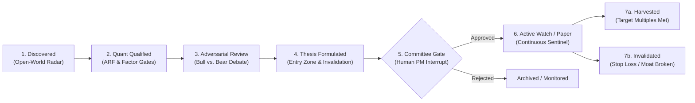

# ARF Digital Investment Analyst & Autonomous Research Partner
## Product Vision, Multi-Agent Architecture & Implementation Roadmap

**Date:** 2026-10-21  
**Status:** Approved Strategic Vision & Architecture Specification  
**Target:** `ARF` (`arf/agent/`, `arf/scoring.py`, `arf/db.py`, `webapp/`)  
**Context:** Autonomous Buy-Side AI Analyst, Digital Investment Employee, Supply Chain Discovery Engine  
**Architectural Pedigree:** Adapted from the Enterprise AI Project Manager Governance Platform (`WoW` / `wow-ai-pm`)

---

## 1. Executive Summary: The Paradigm Shift

Modern quantitative and equity research tools remain fundamentally **passive and reactive**: they store historical snapshots, compute formulaic scores, render static charts, and wait for human analysts to run manual screens or query conversational chatbots.

This document establishes the strategic vision and architectural blueprint to transform **ARF (AI Relevance Factor)** from a passive equity screening dashboard into an autonomous, proactive **Digital Investment Partner & Research Analyst (Digital Employee)**.

```
       CONVENTIONAL ARF (Static)                    AUTONOMOUS ARF (Digital Colleague)
┌──────────────────────────────────────┐     ┌──────────────────────────────────────────────────┐
│ • Weekly batch pipeline              │     │ • 24/7 autonomous market cadence                 │
│ • Static 73-stock coverage universe  │     │ • Open-World AI supply chain exploration         │
│ • Formulaic E and V factor percentiles│ ──▶ │ • Multi-agent Bull vs. Bear adversarial research │
│ • Reactive Streamlit dashboards      │     │ • G1–G4 outside-model deterministic risk gates   │
│ • Manual report exports              │     │ • Living "Opportunity Alpha" state lifecycle     │
└──────────────────────────────────────┘     │ • Grounded NotebookLM citations & audio debriefs │
                                             └──────────────────────────────────────────────────┘
```

By borrowing the battle-tested multi-agent supervisory patterns from **WoW** (`wow-ai-pm`), ARF separates **macro supervisory orchestration** from **specialist task execution**, enforces **outside-model mechanical risk gates**, and tracks ideas through a formal **living state machine**.

---

## 2. Core Concepts: The Investment Meta-Model

Following the foundational ontology of the WoW Governance Engine, the Digital Investment Analyst is governed by four core concepts:

```
┌──────────────────────────────────────────────────────────────────────────────────────────────┐
│                                  ARF INVESTMENT META-MODEL                                   │
├──────────────────────────┬───────────────────────────┬───────────────────────────────────────┤
│ 1. Opportunity Alpha     │ 2. Dual-Layer Execution   │ 3. Deterministic G1–G4 Governance     │
│    Living state machine  │    Supervisor orchestrator│    Outside-model financial guardrails │
│    tracking idea from    │    vs. sandboxed worker   │    where LLM cannot talk itself       │
│    discovery to harvest  │    subagent specialists   │    past capital constraints           │
├──────────────────────────┴───────────────────────────┴───────────────────────────────────────┤
│ 4. Investment Decision Record (IDR) & Grounded Provenance (NotebookLM)                        │
│    5-step causal decision audit trail with clickable source pills for every fact and claim   │
└──────────────────────────────────────────────────────────────────────────────────────────────┘
```

### 2.1 The "Opportunity Alpha" Lifecycle

In WoW, an **Alpha** is an entity whose progress is tracked across ordered, verifiable states. In ARF, an investment thesis is never a static row in a spreadsheet; it is an **Opportunity Alpha** progressing through strict stage gates:



| Lifecycle State | Description | Transition Gate |
|---|---|---|
| **1. Discovered** | Unmapped supplier or beneficiary identified via web search / supply-chain radar | Layer matched (L1–L5), ticker verified in public exchange |
| **2. Quant Qualified** | Automated factor profile computed ($E$ score, $V$ score, ARF decile, ROE, reverse-DCF $g^*$) | Hard G3 gate: $\text{ROE} \ge \text{WACC}$, not froth-flagged |
| **3. Adversarial Review** | Parallel specialist agents conduct forensic accounting and Red-Team cross-examination | Minimum 2 verifiable primary sources cited per claim |
| **4. Thesis Formulated** | Opportunity Card compiled with numerical Valuation Entry Zone and Invalidation Criteria | Quantitative entry zone and structural invalidation defined |
| **5. Committee Gate** | LangGraph `interrupt()` pauses execution for human Fund Manager / CIO review | Human portfolio manager explicit sign-off |
| **6. Active Watch** | Daily sentinel monitors real-time market telemetry, chip profit ratios, and factor drift | Price within entry zone, volume and CYQ support intact |
| **7. Harvested / Invalidated** | Position reaches target multiple or triggers structural thesis invalidation | Automatic post-mortem log and retrospective analysis |

---

## 3. Dual-Layer Multi-Agent Architecture

WoW established the critical distinction between **Supervisor (Governor)** and **Work Package Owner (Specialist Worker)**. Applying this to quantitative equity research:

```
┌────────────────────────────────────────────────────────────────────────────────────────┐
│ 1. USER COCKPIT & COLLABORATIVE WORKSPACE (Streamlit / Next.js)                        │
│    Opportunity Pipeline · Thermal Bubble Gauge · Factor Decomposition · Audio Briefing  │
├────────────────────────────────────────────────────────────────────────────────────────┤
│ 2. INVESTMENT SUPERVISORY BRAIN (LangGraph StateGraph - arf/agent/supervisor/)         │
│    • Daily Scan (GARP, Breakouts, Froth) ──▶ Tolerance & Entry Zone Check              │
│    • Adversarial Deliberation Synthesis ──▶ G3 Mechanical Risk Gate                    │
│    • Human-in-the-Loop interrupt() ──▶ CIO Sign-off on Staging & Universe Promotion    │
├────────────────────────────────────────────────────────────────────────────────────────┤
│ 3. SPECIALIST RESEARCH WORKERS (Sandboxed Subagents - Gemini 3.8 Flash)                │
│    • Supply Chain Traversal Agent (10-K disclosures, customer-supplier graphs)          │
│    • Forensic Quant Agent (Reverse-DCF sensitivity, 扣非 net profit ROE, FX audit)      │
│    • Red-Team Short Seller (ASIC substitution risk, hyperscaler capex deceleration)     │
├────────────────────────────────────────────────────────────────────────────────────────┤
│ 4. DOMAIN REPOSITORY & PROVENANCE KERNEL (DuckDB / Cloud SQL)                          │
│    Single Source of Truth: snapshots · candidate_pool · investment_theses · telemetry  │
└────────────────────────────────────────────────────────────────────────────────────────┘
```

### 3.1 The LangGraph Supervisory StateGraph

The Investment Supervisor runs as an autonomous, cyclic directed graph with durable PostgreSQL / DuckDB checkpointing:

```mermaid
flowchart TD
    START([Market Cadence Trigger]) --> Scan[1. scan_market_anomalies]
    Scan --> CheckDrift[2. evaluate_portfolio_tolerances]
    CheckDrift --> DriftDecision{Anomalies or Drift Detected?}
    
    DriftDecision -- No --> Journal[7. record_market_journal]
    Journal --> END([Cycle Complete])
    
    DriftDecision -- Yes --> DispatchWorkers[3. dispatch_specialist_workers]
    DispatchWorkers --> Synthesize[4. synthesize_investment_thesis]
    Synthesize --> RiskGate{5. mechanical_risk_gate (G3)}
    
    RiskGate -- Rejected / Froth --> AlertFroth[8. emit_risk_warning]
    AlertFroth --> Journal
    
    RiskGate -- Passed PM Band --> StageCandidate[9. stage_to_candidate_pool]
    StageCandidate --> Journal
    
    RiskGate -- High-Conviction Core Admission --> HumanInterrupt[6. human_pm_interrupt (CIO Review)]
    HumanInterrupt -- PM Approves --> PromoteUniverse[10. promote_to_portfolio]
    HumanInterrupt -- PM Rejects --> RefineThesis[11. archive_or_rework]
    
    PromoteUniverse --> Journal
    RefineThesis --> Journal
```

### 3.2 Specialist Worker Agents (Dispatched Subprocesses)

Instead of a single monolithic prompt, task execution is distributed to dedicated specialist worker agents:

1. **Supply Chain Traversal Agent:**
   - *Mission:* Maps customer-supplier dependencies across Jensen Huang's 5 layers.
   - *Tools:* Google Search, SEC EDGAR 10-K Item 1 parser, CapEx tracker.
   - *Output:* Verified key customers, estimated AI revenue percentage (pure-play %), and single-customer concentration metrics.
2. **Forensic Quant & Valuation Agent:**
   - *Mission:* Conducts rigorous financial audits using local reporting currencies.
   - *Tools:* Reverse-DCF solver (`implied_growth`), 扣非 (after non-recurring) ROE calculation, FX normalization (matching trading currency to reporting currency to avoid FCF yield distortion).
   - *Output:* Implied growth rate $g^*$, growth gap vs consensus, historical EV/Sales percentile.
3. **Red-Team Short-Seller Agent:**
   - *Mission:* Adversarially challenges every proposed bull thesis.
   - *Tools:* Financial statement anomaly scanner, ASIC substitution risk analyzer, margin compression monitor.
   - *Output:* Specific invalidation criteria (e.g. *"Gross margin drops below 55%"*, *"Loss of tier-1 optical transceiver allocation"*), bear-case probability, and downside valuation floor.

---

## 4. Deterministic Governance Guarantees (G1–G4) for Capital

In generative AI, hallucinations in creative writing are harmless; in asset management, hallucinations and narrative FOMO cause permanent capital impairment. ARF implements WoW's **Governance Guarantees**:

```
┌────────────────────────────────────────────────────────────────────────────────────────┐
│                              G1–G4 GOVERNANCE GUARANTEES                               │
├────────────────────────────────────────────────────────────────────────────────────────┤
│ G1: Witnessed Mutation · Every thesis change, entry zone adjustment, or portfolio      │
│     promotion is logged with timestamp, model identifier, and rationale.               │
├────────────────────────────────────────────────────────────────────────────────────────┤
│ G2: Data Provenance · Every claim must cite verified primary data (SEC filing,         │
│     AkShare financial statement, or verified earnings transcript).                     │
├────────────────────────────────────────────────────────────────────────────────────────┤
│ G3: Outside-Model Circuit Breaker · Deterministic Python predicates enforce financial   │
│     sanity. An LLM cannot talk itself into recommending a bubble.                      │
├────────────────────────────────────────────────────────────────────────────────────────┤
│ G4: Dual-Grade Authority · Agent touch_grade (research/query) is separate from         │
│     commit_grade (capital allocation / core universe admission).                        │
└────────────────────────────────────────────────────────────────────────────────────────┘
```

### 4.1 The G3 Mechanical Risk Gate (Code-Level Predicate)

```python
def mechanical_risk_gate(profile: dict[str, Any], thesis: dict[str, Any]) -> GovernanceResult:
    """Deterministic outside-model risk gate. Executes independently of LLM reasoning."""
    # 1. Bubble & Froth Guardrail
    if profile.get("froth_flag") is True and thesis.get("thesis_type") == "long_opportunity":
        return GovernanceResult(
            passed=False, 
            verdict="BLOCKED_BY_G3",
            reason="G3 Gate: Target is froth-flagged (ARF in D1, ROE < WACC, P/S > 25)."
        )

    # 2. Capital Return Guardrail for GARP
    cost_of_equity = 0.10 if profile.get("leg") == "US" else 0.12
    if thesis.get("thesis_type") == "garp_value" and profile.get("roe", 0) < cost_of_equity:
        return GovernanceResult(
            passed=False,
            verdict="BLOCKED_BY_G3",
            reason=f"G3 Gate: ROE ({profile.get('roe'):.1%}) fails hurdle rate ({cost_of_equity:.1%})."
        )

    # 3. Explicit Invalidation Requirement
    if not thesis.get("invalidation_criteria") or len(thesis["invalidation_criteria"]) < 20:
        return GovernanceResult(
            passed=False,
            verdict="BLOCKED_BY_G3",
            reason="G3 Gate: Opportunity Card lacks verifiable, quantitative invalidation criteria."
        )

    return GovernanceResult(passed=True, verdict="PASSED")
```

---

## 5. The Investment Decision Record (IDR)

Mirroring WoW's **Agent Decision Record (ADR)**, every thesis produced by the Digital Analyst generates a structured, immutable **Investment Decision Record (IDR)** ensuring 100% causal explainability:

```
┌────────────────────────────────────────────────────────────────────────────────────────┐
│                        INVESTMENT DECISION RECORD (IDR) SCHEMA                         │
├────────────────────────────────────────────────────────────────────────────────────────┤
│ 1. TRIGGER & OBSERVATION                                                               │
│    • Market Event: Lumentum (LITE) pulled back 12% to $68.50, entering D4 valuation.   │
│    • Factor Readings: E_score=88, V_score=52, Implied Growth Gap=-4.2%, CYQ Support=81%│
├────────────────────────────────────────────────────────────────────────────────────────┤
│ 2. NORMATIVE BASIS & POLICIES EVALUATED                                                │
│    • Investment Mandate: US Layer 3 (Optical Transceivers & Networking)                │
│    • Policy Bounds: WACC=10.0%, Max P/S=28.0, Minimum CYQ Profit Ratio=70%            │
├────────────────────────────────────────────────────────────────────────────────────────┤
│ 3. ADVERSARIAL DELIBERATION                                                            │
│    • Bull Case: Blackwell 1.6T transceiver ramp; strategic supplier allocation.        │
│    • Bear Case: Customer concentration with Top 2 cloud hyperscalers exceeding 65%.    │
│    • Trade-Off Verdict: Risk/Reward asymmetry favorable above $65.00 support.          │
├────────────────────────────────────────────────────────────────────────────────────────┤
│ 4. OUTSIDE-MODEL AUTHORITY GATE (G3)                                                   │
│    • Froth Flag Check: FALSE (Passed)                                                  │
│    • Hurdle Check: ROE 22.4% > WACC 10.0% (Passed)                                     │
│    • Gate Outcome: Approved for Staging / Flagged for Human PM Decision                │
├────────────────────────────────────────────────────────────────────────────────────────┤
│ 5. ACTION TAKEN & HUMAN PM SIGN-OFF                                                    │
│    • Entry Zone: $65.00 – $70.00 | Stop-Loss Invalidation: Gross Margin < 42.0%        │
│    • Human PM Sign-Off: [APPROVED by Sheng on 2026-10-21]                              │
└────────────────────────────────────────────────────────────────────────────────────────┘
```

---

## 6. The Flagship Google AI & Cloud Showcase Stack

ARF is engineered as an institutional showcase of Google’s complete enterprise AI, multi-modal, and cloud infrastructure:

```
┌────────────────────────────────────────────────────────────────────────────────────────┐
│                   ARF × GOOGLE ENTERPRISE AI & CLOUD SHOWCASE                          │
├────────────────────────────────────────────────────────────────────────────────────────┤
│ 1. CORE REASONING & RESEARCH ENGINE                                                    │
│    • Gemini 3.8 Flash: Sub-second latency workhorse powering the Radar Agent,          │
│      anomaly screening, adversarial Bull vs. Bear debate, and deterministic G3 gates.  │
│    • Gemini 2.5 Pro (2M Context): Full-filing ingestion engine digesting complete      │
│      SEC 10-Ks, 10-Qs, earnings transcripts, and Taiwan supply chain ledgers in a      │
│      single prompt without lossy vector chunking.                                      │
├────────────────────────────────────────────────────────────────────────────────────────┤
│ 2. REAL-TIME GOOGLE SEARCH GROUNDING                                                   │
│    • Native Google Search tool integration directly inside GenAI SDK pipelines.        │
│    • Extracts grounding metadata, web search queries, and domain citations, anchoring │
│      every analytical assertion in verifiable primary facts.                            │
├────────────────────────────────────────────────────────────────────────────────────────┤
│ 3. VISUAL INFOGRAPHICS & SLIDES: NANO BANANA 2 / 2.1                                    │
│    • Google's pro-grade high-speed image generation model with precision typography    │
│      and multi-image consistency.                                                      │
│    • Autonomously renders institutional Investment Decision Cards, supply chain        │
│      dependency maps, and 16:9 Investment Committee slide visuals.                     │
├────────────────────────────────────────────────────────────────────────────────────────┤
│ 4. CINEMATIC VIDEO EXECUTIVE BRIEFS: VEO 2                                             │
│    • Google DeepMind's flagship video generation model delivering high-definition      │
│      1080p video with temporal consistency and realistic physics.                     │
│    • Synthesizes 60-second executive video briefings illustrating valuation multiple   │
│      compression, supply-chain chokepoints, and data center hardware architectures.    │
├────────────────────────────────────────────────────────────────────────────────────────┤
│ 5. GENERATIVE MUSIC & AUDIO SOUNDSCAPES: LYRIA / MUSICFX                               │
│    • Google DeepMind's premier music generation engine.                                │
│    • Composes custom, adaptive tech-finance audio branding: crisp podcast intros,      │
│      subtle ambient tension underscoring forensic risk cross-examinations.             │
├────────────────────────────────────────────────────────────────────────────────────────┤
│ 6. CONVERSATIONAL IC PODCAST: GOOGLE CLOUD JOURNEY TTS                                 │
│    • Ultra-realistic dual-voice dialogue: en-US-Journey-F (Lead Tech Growth Analyst)   │
│      vs. en-US-Journey-D (Forensic Risk Officer & Short Seller).                       │
│    • Produces 3-minute daily executive audio debriefs (NotebookLM paradigm).           │
├────────────────────────────────────────────────────────────────────────────────────────┤
│ 7. SERVERLESS GCP ARCHITECTURE (GCP Project: ai-rf-497701, Region: asia-east1)         │
│    • Cloud Run & Cloud Run Jobs: Instant scale, zero idle server cost.                 │
│    • Cloud Scheduler: Automated 08:30 pre-market and post-market execution triggers.   │
│    • Google Cloud Storage (GCS: arf-data-ai-rf): Versioned parquet data lake.          │
│    • Secret Manager: Enterprise-grade zero-leak API credential isolation.              │
├────────────────────────────────────────────────────────────────────────────────────────┤
│ 8. NVIDIA GPU ACCELERATION ON GOOGLE CLOUD                                              │
│    • Hardware Symbiosis: Modeling Jensen Huang's AI stack while executing compute on   │
│      NVIDIA GPUs (L4 / H100 / Blackwell B200) hosted in Google Cloud (G2 / A3 VMs).    │
│    • GPU-Accelerated Cloud Run & Batch: Serverless micro-bursts for 100,000-path        │
│      Monte Carlo reverse-DCF sensitivity and GPU-parallel CYQ chip distribution math.   │
└────────────────────────────────────────────────────────────────────────────────────────┘
```

### 6.1 The Google Cloud × NVIDIA GPU Strategic Synergy

ARF models the AI value chain whose centerpiece is NVIDIA. By utilizing **NVIDIA GPUs hosted inside Google Cloud**, ARF creates a profound, high-leverage architectural showcase:

1. **Ecosystem Recursion & Symbiosis:**
   - ARF computes the AI Relevance Factor (ARF) for NVIDIA (NVDA) and its critical chokepoints (TSMC, ASML, Innolight, Vertiv).
   - The platform’s deep quantitative modeling, Monte Carlo simulation kernels, and media synthesis pipelines execute directly on Google Cloud infrastructure accelerated by NVIDIA hardware (such as Google Cloud G2 instances with NVIDIA L4 GPUs, or A3 instances with NVIDIA H100s).
   - This provides the ultimate demonstration of the **Google Cloud × NVIDIA enterprise alliance**.

2. **High-Performance Quantitative Acceleration:**
   - **Tensor-Accelerated Reverse-DCF Monte Carlo:** Rather than evaluating a single static DCF growth gap, the system simulates 100,000 stochastic revenue, WACC, and operating margin paths in milliseconds using GPU tensor arithmetic (PyTorch / CuPy).
   - **Real-Time CYQ Chip Distribution (筹码分布):** Parallelized price-volume density calculations across millions of exchange ticks executed across the entire 73-stock universe simultaneously.
   - **On-Demand Serverless GPU Economics:** Using Google Cloud Run’s GPU-enabled runtime (e.g. NVIDIA L4), GPU resources scale from zero to active execution exclusively during scheduled runs or on-demand user analysis, ensuring zero idle GPU hosting costs.

---

## 7. The Multi-Modal Studio: Grounded Sources, Podcasts, Infographics & Video Briefs

ARF turns dry quantitative data into an engaging multi-modal executive intelligence experience:

### 7.1 Grounded Provenance & Source Citations
Every assertion in an Opportunity Card or valuation debrief includes clickable citation pills linking directly to verified documents:
- `[SEC 10-K §Item 7 - Segment Revenue]`
- `[AkShare 2025Q3 扣非净利润披露]`
- `[Taiwan MoEA Optical Transceiver Export Ledger]`
- `[ARF Factor Snapshots: 2026-10-04]`

### 7.2 The 2-Host "Investment Committee Podcast" (Deep Dive Audio Overview)
Borrowing from NotebookLM, the platform compiles a **3-minute conversational audio debate** between two distinct digital investment colleagues:

```
Host 1: "Alex" (Lead Tech Growth Analyst — Google Cloud Journey Voice F)
  "Good morning. Today our optical radar picked up Lumentum pulling back into Decile 4.
   With 1.6T transceivers hitting volume production for GB200 racks, the market seems to be
   underestimating their operating leverage..."

Host 2: "Marcus" (Forensic Risk Officer & Short Seller — Google Cloud Journey Voice D)
  "Hold on, Alex. Look at the reverse-DCF numbers. The market is still pricing in a 24% 
   implied FCF CAGR. If hyperscalers moderate capex or ASIC interconnects take share, 
   that multiple compresses fast. Did the team check their customer concentration in 10-K?"
```

- **Audio Production:** Lyria generates the subtle corporate tech ambient bed that underscores the debate, swelling during key catalyst disclosures.

### 7.3 Visual Infographics via Nano Banana 2
For every formulated thesis, ARF invokes Google Nano Banana 2 to render a high-resolution, institutional-grade infographic slide:
- Clean typography displaying the target ticker, layer badge, ARF decile, and reverse-DCF implied growth gap.
- Stylized visual schematic of the company's product in the AI value chain (e.g. 1.6T DSP optical engine, liquid cooling cold plate, CoWoS packaging substrate).
- Branded risk vs. reward matrix suitable for immediate inclusion in an Investment Committee slide deck.

### 7.4 60-Second Video Executive Briefs via Veo 2
For high-conviction opportunities (Confidence Score $\ge 85\%$), ARF compiles a prompt sequence for Google DeepMind Veo 2:
- Dynamic cinematic camera pans over a 3D visualization of the AI hardware rack (L1/L2/L3).
- Overlaying animated valuation trajectories and key catalyst countdowns.
- Tailored for CIO mobile review and executive Slack/Teams channels.

---

## 8. The Google AI Showcase Experience

To highlight Google's technological leadership to stakeholders and clients, ARF features a dedicated **Google AI Showcase Cockpit**:

1. **Live Model Selector & Latency Benchmark:** Real-time side-by-side comparison between Gemini 3.8 Flash (rapid filtering) and Gemini 2.5 Pro (deep reasoning).
2. **Interactive Grounding Inspector:** Visual inspection panel displaying the raw Google Search queries, grounding chunks, and web source attributions returned by the GenAI API.
3. **Multi-Modal Generation Studio:** One-click generation of:
   - The 5-step Investment Decision Record (Gemini 3.8 Flash).
   - Institutional infographic slide (Nano Banana 2).
   - 3-Minute Dual-Voice Audio Podcast (Lyria + Journey TTS).
   - 60-Second Cinematic Video Brief preview (Veo 2).
4. **Causal Audit Trail:** Complete JSON and visual inspection of the IDR causal chain stored in DuckDB and replicated to Google Cloud Storage.

---

## 9. Phased Implementation Roadmap

```
2026 Q4                      2026 Q4                      2027 Q1                      2027 Q1
Phase 1: State & IDR         Phase 2: G3 Sentinel         Phase 3: Supervisory Pulse   Phase 4: Multi-Modal Studio
┌─────────────────────────┐  ┌─────────────────────────┐  ┌─────────────────────────┐  ┌─────────────────────────┐
│ • Opportunity Alpha     │  │ • Outside-model python  │  │ • Daily LangGraph loop  │  │ • Grounded citations    │
│   state machine schema  │  │   G3 circuit breaker    │  │ • 08:30 Market Cadence  │  │ • Lyria + Journey TTS   │
│ • 5-step IDR database   │  │ • Mechanical Froth Gate │  │ • Proactive Entry Zone  │  │ • Nano Banana 2 Slides  │
│   persistence in DuckDB │  │ • Hurdle rate verifier  │  │   alert triggers        │  │ • Veo 2 Video Briefs    │
│ • Gemini 3.8 Flash Core │  │ • Strict G1-G4 gates    │  │ • CIO Human-in-the-Loop │  │ • Google AI Showcase UI │
└─────────────────────────┘  └─────────────────────────┘  └─────────────────────────┘  └─────────────────────────┘
```

### Phase 1: Opportunity Alpha State Machine & IDR Persistence (Active)
- Formalize `OpportunityStage` and `GateVerdict` in `arf/agent/schemas.py`.
- Define the 5-step `InvestmentDecisionRecord` (Trigger, Normative Basis, Deliberation, Gate Verdict, Action & Boundaries).
- Build persistent tables and migration in `arf/db.py`.
- Upgrade `arf/agent/thesis.py` to compile and store IDRs with Gemini 3.8 Flash.
- Verify comprehensive test coverage (>90%).

### Phase 2: Outside-Model G3 Risk Sentinel
- Implement `arf/agent/governance.py` containing deterministic Python risk gates.
- Strict Froth and Capital Return Hurdle circuit breakers executing outside the LLM reasoning loop.

### Phase 3: Autonomous Supervisory Brain & Daily Market Cadence
- Implement `arf/agent/supervisor/graph.py` using LangGraph.
- 08:30 Pre-Market pulse and Intraday Anomaly Sentinel with Human-in-the-Loop (`interrupt()`).

### Phase 4: Multi-Modal Studio & Google AI Showcase
- Source-grounded citation pills in Streamlit UI.
- Dual-voice Audio IC Podcast with Google Cloud Journey TTS and Lyria theme music.
- Nano Banana 2 visual slide generator and Veo 2 video executive briefing generator.
- Interactive Google AI Showcase page.

---

## 10. Architectural Summary

By combining WoW’s proven methodology-compiler and supervisory patterns with the best of Google AI:
1. **The Quantitative Engine (`arf/scoring.py`)** provides the unyielding mathematical anchor.
2. **Gemini 3.8 Flash & Gemini 2.5 Pro** provide world-class reasoning and long-context filing comprehension.
3. **The G3 Governance Kernel** ensures generative AI never overrules mechanical risk boundaries.
4. **Nano Banana 2, Veo 2, Lyria, and Journey TTS** elevate quantitative equity research into a compelling, institutional-grade multi-modal experience.
5. **The Human Portfolio Manager (`interrupt()`)** remains firmly in control of all capital allocation decisions.

