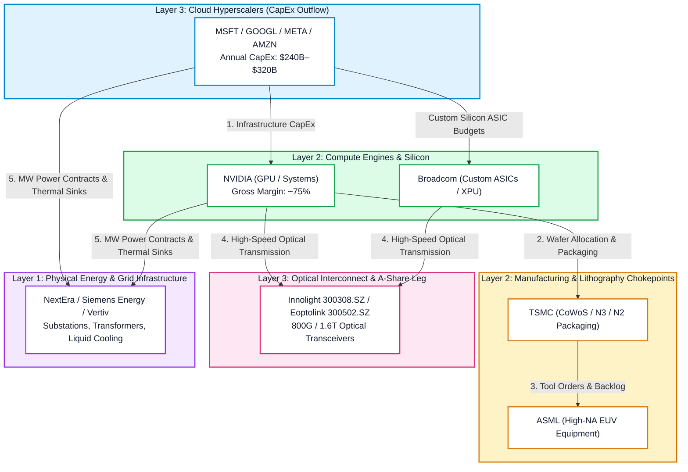
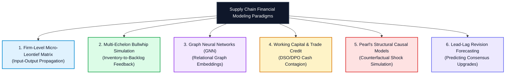

se an# Connecting the Dots: Value Chain Financial Modeling, Supply Chain Transmission, and Autonomous AI-CIO Architecture

**Document ID:** `AI-CIO-TECH-002`  
**Date:** 2026-10-28  
**Status:** Approved Strategic Architectural Specification  
**Target:** `ARF` / `AI-CIO` (`arf/cio.py`, `arf/value_chain.py`, `arf/scoring.py`, `webapp/pages/10_💼_CIO_投资总监.py`)  
**Cross-References:** [`docs/ADR-001`](file:///Users/sheng/Developer/ARF/docs/ADR-001-Next-Gen-Modeling-and-Lightweight-Ontology-for-Agents.md), [`docs/ARF_DIGITAL_INVESTMENT_ANALYST_VISION.md`](file:///Users/sheng/Developer/ARF/docs/ARF_DIGITAL_INVESTMENT_ANALYST_VISION.md)

---

## 1. Executive Thesis: From Stock Silos to Closed Financial Circuits

The central paradox of agentic AI in modern finance is the divergence between **initiation speed** and **decision-grade reliability**:
* Large language models (LLMs) can extract unstructured filings, generate preliminary summaries, and spread historical numbers in seconds.
* However, autonomous neural networks consistently fail at deterministic multi-statement accounting, debt waterfall loops, and non-linear mathematical feedback (scoring **0/10 on circularity** in institutional benchmarks).

In conventional sell-side research and naive quantitative screening, equities are analyzed as **isolated corporate silos**: an analyst reviews an isolated Nvidia report, an isolated Microsoft earnings release, or an isolated Innolight (300308.SZ) valuation multiples sheet. 

For an **autonomous AI-CIO (Chief Investment Officer)**, this approach is fundamentally invalid:
> **Companies in an industrial revolution do not exist in isolation. They are interconnected physical nodes in a closed thermodynamic, supply-chain, and financial cash-flow circuit.**

An AI-CIO cannot identify systemic risk, assess pricing power, or spot bubble divergence by looking at individual multiples in a vacuum. It must model the **transmission plumbing** connecting suppliers, foundries, cloud platforms, and enterprise software customers.



---

## 2. The Four Financial Transmission Mechanisms

Within our 73-stock universe across the US and China legs (`config/universe.yaml`, `config/value_chain.yaml`), deterministic financial modeling connects companies across four fundamental economic mechanisms:

### 2.1 The CapEx-to-Revenue Closed Circuit (Conservation of Cash Flows)
Every dollar of capital expenditure spent by downstream mega-cap buyers represents the top-line addressable market for upstream component makers:
$$\sum \text{CapEx}_{\text{Hyperscalers (L3)}} \times \alpha_{\text{AI Infrastructure \%}} \times \beta_{\text{BoM Component \%}} \equiv \text{Revenue}_{\text{NVDA / AVGO (L2)}}$$
$$\text{Wafer Demand}_{\text{NVDA}} \times \text{Price}_{\text{CoWoS}} \equiv \text{Revenue}_{\text{TSMC}}$$

* **Connecting the Dots:** If Microsoft, Alphabet, Meta, and Amazon guide to \$250B in combined CapEx, an isolated model only asks whether Microsoft can service its debt. 
* **The Systemic Model:** Allocates that \$250B across the hardware Bill of Materials (BoM). If Nvidia’s current stock price requires \$180B in annual data center revenue to justify its valuation, but hyperscaler CapEx is decelerating to 10% YoY growth, the model detects a **macro revenue deficit**. While probabilistic LLMs generate optimistic narratives, the mathematical model proves that aggregate cash flows cannot clear.

### 2.2 Margin Transfer & Pricing Power Propagation
When input costs shift along the chain (e.g., TSMC raises 3nm wafer prices by 8%, or industrial electricity rates surge in PJM/ERCOT):
* **Economic Absorption vs. Pass-Through:** Does Nvidia absorb the cost, compressing its 75% gross margin, or pass it 100% to cloud providers?
* **The Downstream Squeeze:** Cloud hyperscalers can only pass infrastructure costs downstream if enterprise customers are willing to pay for software applications (Layer 5). If enterprise Copilot ROI cannot justify \$30/user/month, **margins become trapped and compressed in Layer 3 and Layer 5**, while **Layer 2 (monopolistic silicon) and Layer 1 (power generators) extract all economic rents**.
* **The Model’s Role:** Dynamically computes margin elasticity across layers, isolating which nodes possess structural pricing power versus those facing margin erosion.

### 2.3 Cross-Border Dual Value Chain Arbitrage (US vs. China vs. Europe)
As detailed in [`Reference/The Global Architecture of Artificial Intelligence...`](file:///Users/sheng/Developer/ARF/Reference/The%20Global%20Architecture%20of%20Artificial%20Intelligence_%20A%20Layer-by-Layer%20Topographical%20Map%20of%20the%20US%2C%20China%2C%20and%20Europe.md):
* **Optical Interconnect Interdependence:** US hyperscalers (Meta, Google) and Nvidia rely on Chinese optical transceivers (**Innolight 300308.SZ**, **Eoptolink 300502.SZ**) for up to 60%+ of their 800G/1.6T optical interconnects.
* **Domestic Substitution Dynamics:** Under strict US export controls, China’s tier-1 internet giants redirect capital from Nvidia to domestic accelerators (**Huawei Ascend 910B/C**, **Cambricon 688256.SH**), fabricated domestically at **SMIC (688981.SH)**.
* **European Physical Chokepoints:** Neither the US nor China can produce advanced semiconductors without Dutch extreme ultraviolet lithography (**ASML**), nor power their mega-datacenters without German and French high-voltage switchgear and transformers (**Siemens Energy**, **Schneider Electric**).
* **The Model’s Role:** Normalizes multi-currency accounting (matching local reporting currency FCF to local market caps to eliminate foreign exchange distortions) and models the cross-border impact of tariff or export policy shocks.

### 2.4 Reverse-DCF Implied Growth Harmonization ($g^*$ Consistency)
In [`arf/scoring.py`](file:///Users/sheng/Developer/ARF/arf/scoring.py) and [`arf/implied.py`](file:///Users/sheng/Developer/ARF/arf/implied.py), we solve for the market-implied cash flow growth rate ($g^*$) required to justify prevailing market prices:
$$P_0 = \sum_{t=1}^{10} \frac{\text{FCF}_0 \cdot (1 + g^*)^t}{(1 + \text{WACC})^t} + \frac{\text{Terminal Value}}{(1 + \text{WACC})^{10}}$$

* **Connecting the Dots:**
  * If **Nvidia (L2)** trades at a valuation implying a 10-year FCF compound growth rate ($g^*$) of **38%**,
  * While its key customers **Microsoft & Google (L3)** imply an aggregate growth rate of **15%**,
  * And downstream enterprise software giants (**Salesforce, ServiceNow, Adobe, L5**) imply growth of **9%**:
* **The Systemic Red Flag:** Upstream suppliers cannot compound at 38% for a decade if their downstream customers are growing at 9%. The mathematical divergence flags structural over-anticipation, triggering our **Froth Flag** (`ARF in D1 AND ROE < cost_of_equity AND P/S > 25`).

---

## 3. Landscape of Similar Work: Industry & Academic Benchmarks

How does ARF / AI-CIO compare to institutional platforms and academic quant literature?

### 3.1 Commercial & Enterprise Platforms

| Platform / Vendor | Core Methodology | Strengths | Architectural Limitations vs. AI-CIO |
| :--- | :--- | :--- | :--- |
| **Bloomberg SPLC (Supply Chain Analysis)** | Disclosed customer/supplier graph from SEC filings, annual reports, and capital IQ feeds. | Massive global coverage (~100,000+ relationships), revenue share approximations. | Purely descriptive/historical; no forward-looking causal propagation; no embedded reverse-DCF or dual-value-chain stack logic. |
| **FactSet Revere Supply Chain Relationships** | Granular product taxonomy classification with multi-tier customer/supplier matrices. | Precise intermediate good mapping; normalized customer concentration percentages. | Static data feed; lacks autonomous agentic reasoning; does not enforce cross-company cash flow conservation. |
| **S&P Global Market Intelligence (Quantamental Supply Chain)** | Systematic alpha factors: Upstream (Customer) Momentum and Downstream (Supplier) Capacity constraints. | Rigorous backtested factor premia; proves supply-chain momentum leads analyst revisions by 3–6 weeks. | Passive quantitative factor; lacks interactive CIO governance, multi-agent adversarial debate, and live contract parsing. |
| **Palantir Foundry (Supply Chain Twin)** | Operational digital twin for industrial procurement, logistics, and bill of materials (BoM) simulation. | World-class enterprise data integration; dynamic bottleneck simulation and ERP write-back. | Built for enterprise operational logistics (BOM/shipping), not equity valuation, cross-border capital allocation, or alpha generation. |
| **Fintech AI Platforms (Hebbia, Rogo, Toggle AI, Causaly)** | LLM retrieval over virtual data rooms (VDRs), SEC filings, and pitchbooks. | High-speed semantic extraction; automated comp sheet roll-forwards. | Probabilistic only; treats companies as discrete documents; does not run an underlying multi-echelon network simulation engine. |

### 3.2 Quantitative Hedge Fund Strategies & Academic Foundations

1. **The Customer Momentum Anomaly (Cohen & Frazzini, 2008):**
   * *The Landmark Research:* Demonstrated that stock prices underreact to news transmitted across economic links. A long-short portfolio buying suppliers whose major customers had strong recent returns (and shorting suppliers whose customers had weak returns) generated risk-adjusted alpha of **15.8% annually**.
   * *Mechanism:* Investors have bounded attention and cover individual sectors; they fail to immediately re-rate a mid-cap supplier when a mega-cap customer beats earnings.
2. **Input-Output Shock Propagation (Barrot & Sauvagnat, 2016; Acemoglu et al., 2012):**
   * Proved that localized disruptions (e.g., natural disasters, factory shutdowns) at a specific supplier propagate downstream to customers who cannot easily substitute specific inputs, wiping out multiples of the supplier’s market value in customer equity.
3. **Cross-Asset Lead-Lag Quant Desks (Citadel, Two Sigma, Point72):**
   * Modern quantitative desks maintain proprietary graphs tracking *Revenue Attribution Matrices* ($W$). If Company A reports an unexpected 30% jump in data center CapEx, systematic trading engines immediately front-run consensus revisions across Company A's tier-1 and tier-2 suppliers before sell-side analysts publish updated target prices.

---

## 4. Alternative Methodologies for Modeling Supply Chain Relationships & Financial Performance

To extend ARF's value-chain modeling, six formal quantitative and mathematical paradigms can be integrated into the AI-CIO architecture:



### 4.1 Firm-Level Micro-Leontief Input-Output Matrix
Adapted from Wassily Leontief’s macroeconomic Nobel-prize-winning framework to firm-level equities:
* Let $W$ be an $N \times N$ weighted adjacency matrix where $w_{ij}$ represents the share of firm $i$'s total production inputs purchased from supplier $j$.
* Under a Leontief production function with low short-run input substitutability:
$$x = (I - W)^{-1} f$$
Where:
* $x$ is the vector of total gross output (revenue) across all companies.
* $f$ is the vector of final consumer/enterprise end-demand.
* **$(I - W)^{-1}$ is the Leontief Inverse Matrix**, which captures all direct (1-hop) and indirect (2-hop, 3-hop) multi-tier supply chain dependencies.
* **Application in AI-CIO:** Allows the system to answer: *"If final demand for generative AI software (L5) drops by \$10B, what is the exact mathematical revenue decline across every Tier-1, Tier-2, and Tier-3 supplier down to TSMC and ASML?"*

### 4.2 Multi-Echelon Bullwhip & Inventory Feedback Modeling (Forrester / Sterman)
Supply chains do not transmit demand linearly; they experience the **Bullwhip Effect**:
* A small 5% shift in end-user software demand triggers a 15% adjustment in cloud server procurement, a 35% adjustment in GPU chip orders, and an 80% fluctuation in wafer starts and inventory buildup.
* **System Dynamics Modeling:** Tracks multi-echelon stages:
$$\frac{d\text{Inventory}_i}{dt} = \text{Production Deliveries}_i - \text{Customer Shipments}_i$$
$$\text{Orders Placed}_{i} = \text{Expected Demand}_i + \frac{\text{Target Inventory}_i - \text{Actual Inventory}_i}{\text{Adjustment Time}}$$
* **Application in AI-CIO:** Identifies *inventory bubbles*. When upstream semiconductor suppliers (e.g., optical transceivers or memory chips) report triple-digit growth, the model determines whether real end-users are consuming the hardware or if customers are double-ordering out of panic.

### 4.3 Heterogeneous Graph Neural Networks (GNNs & Relational GCNs)
For complex corporate networks with diverse edge types (`supplies_to`, `competes_with`, `owns_equity_in`, `licenses_patent_from`):
* Uses Relational Graph Convolutional Networks (R-GCN) or Temporal Graph Attention Networks (TGAT).
* Node embeddings update via neighbor message passing:
$$h_i^{(l+1)} = \sigma \left( \sum_{r \in R} \sum_{j \in N_i^r} \frac{1}{c_{i,r}} W_r^{(l)} h_j^{(l)} + W_0^{(l)} h_i^{(l)} \right)$$
* **Application in AI-CIO:** Predicts unobserved connections (discovering secret or unannounced suppliers) and classifies which companies belong in the true supply-chain path of a new architectural standard (e.g., transitioning from copper cabling to co-packaged optics [CPO]).

### 4.4 Working Capital & Trade Credit Contagion Modeling
Supply chains are linked not only by physical shipments but by balance sheet liabilities:
* A supplier’s Accounts Receivable (A/R) is its customer’s Accounts Payable (A/P).
* If an aggressive customer stretches its Days Payable Outstanding (DPO) to conserve cash, the supplier's Days Sales Outstanding (DSO) blows out, draining working capital.
* **Application in AI-CIO:** Links balance sheets across nodes:
$$\Delta \text{Working Capital}_{\text{Supplier}} \leftarrow f(\Delta \text{Payment Terms}_{\text{Customer}})$$
* Catches channel stuffing, vendor financing gimmicks, and liquidity crises before they hit reported earnings.

### 4.5 Pearl’s Structural Causal Models (SCM) & Counterfactual Stress Testing
Judea Pearl’s causal inference framework bridges the gap between statistical correlation and financial cause-and-effect:
* Defines a Directed Acyclic Graph (DAG) with structural equations:
$$Y := f_Y(\text{Predecessors}(Y), U_Y)$$
* Applies Pearl’s **$do$-operator** to run counterfactual simulations:
$$P(\text{EBITDA}_{\text{Innolight}} \mid do(\text{US Export Ban on CoWoS} = 1))$$
* **Application in AI-CIO:** The CIO can execute policy shock simulations that have never occurred in historical price data, observing how the shock cascades across margins and balance sheets.

### 4.6 Lead-Lag Consensus Revision Forecasting
Sell-side analysts update price targets and earnings estimates with significant latency:
* **The Alpha Signal:** By modeling customer quarterly earnings beats ($+\Delta \text{EPS}_{\text{Customer}}$) alongside Capex revisions, the AI-CIO models the predictable revision schedule of suppliers:
$$\mathbb{E}[\text{Consensus Revision}_{\text{Supplier}, t+30d}] = \beta_1 (\text{Surprise}_{\text{Customer}, t}) \times \text{Revenue Dependency} \% + \epsilon$$
* **Application in AI-CIO:** Enables the fund to position in unrated or neglected suppliers weeks before Wall Street consensus upgrades their earnings forecasts.

---

## 5. Architectural Implementation Blueprint for AI-CIO

Building upon [`docs/ADR-001`](file:///Users/sheng/Developer/ARF/docs/ADR-001-Next-Gen-Modeling-and-Lightweight-Ontology-for-Agents.md), our implementation integrates these methodologies into a robust, deterministic multi-agent system:

```
┌────────────────────────────────────────────────────────────────────────────────────────┐
│ 1. UNSTRUCTURED TRAVERSAL TIER (Gemini 3.8 Flash / Specialist Subagents)               │
│    • Ingests 10-K Item 1 & Item 7 disclosures, customs manifests, and call transcripts  │
│    • Extracts customer concentration weights: w_ij = Revenue(i from j) / Revenue(i)    │
│    • Normalizes multi-currency reporting (扣非 net profit, local currency DCF)         │
├────────────────────────────────────────────────────────────────────────────────────────┤
│ 2. DETERMINISTIC GRAPH & PLUMBING ENGINE (Python networkx + DuckDB)                     │
│    • In-memory directed acyclic graph (DAG) representing the 5-layer AI cake           │
│    • Micro-Leontief shock propagation: evaluates (I - W)^(-1) across nodes             │
│    • Reverse-DCF solver: computes implied growth g* and growth gap per node            │
├────────────────────────────────────────────────────────────────────────────────────────┤
│ 3. RISK GATES & GOVERNANCE GUARDS (G1–G4 Outside-Model Clamps)                         │
│    • "Guards Must Bite": LLMs cannot talk themselves past capital limits or P/S rules  │
│    • Mathematical consistency check: flags when supplier g* > 2x customer g*          │
│    • Froth Flag: automatically triggers on valuation-profitability divergence          │
├────────────────────────────────────────────────────────────────────────────────────────┤
│ 4. AI-CIO EXECUTIVE COCKPIT (Streamlit / webapp/pages/10_💼_CIO_投资总监.py)          │
│    • Portfolio rebalancing recommendations based on supply-chain bottlenecks           │
│    • Value-chain margin transfer visualization                                         │
│    • Interactive counterfactual shock simulator (e.g. "Simulate 20% Hyperscaler CapEx Cut")│
└────────────────────────────────────────────────────────────────────────────────────────┘
```

### Summary: The Strategic Advantage

By fusing **probabilistic multi-agent ingestion** with **deterministic value-chain financial modeling**, the AI-CIO solves the ultimate challenge of modern institutional finance:

1. **Eliminates Hallucination:** Every financial calculation (reverse-DCF, working capital, gross margin) is evaluated deterministically in code with zero token-prediction errors.
2. **Reveals Hidden Asymmetries:** It detects when downstream exuberance is not supported by upstream component orders, or when upstream suppliers are severely underpriced relative to contractual CapEx commitments.
3. **Institutional Accountability:** Every thesis is backed by a verifiable proof tree and mathematical tie-out that can be defended in front of an Investment Committee or board of trustees.

