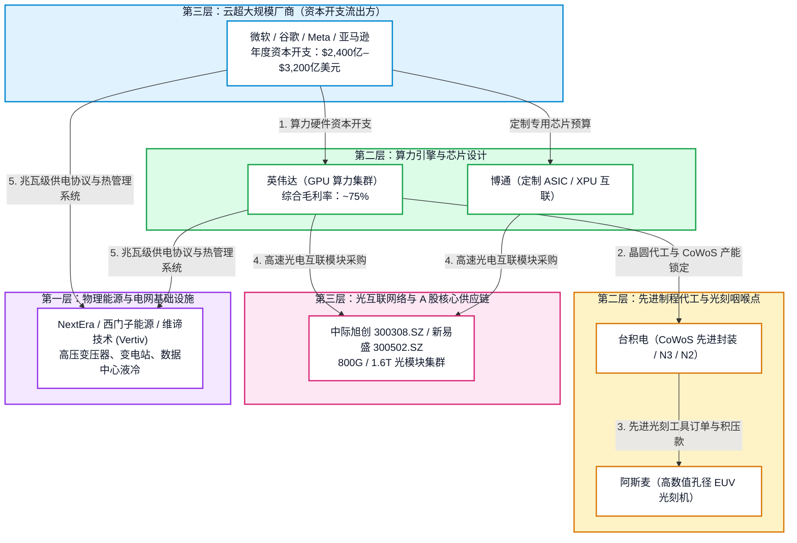
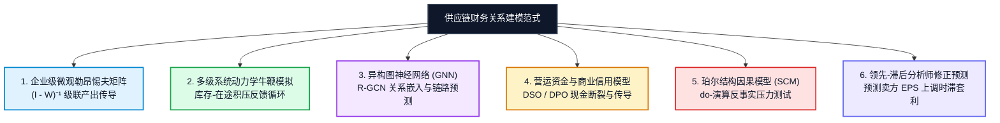

# 串点成网：AI-CIO 价值链金融建模、供应链传导机制与自主投资架构

**文档编号：** `AI-CIO-TECH-002-ZH`  
**发布日期：** 2026-10-28  
**架构状态：** 已批准核心规范（Approved Architecture Specification）  
**适用模块：** `ARF` / `AI-CIO` (`arf/cio.py`, `arf/value_chain.py`, `arf/scoring.py`, `webapp/pages/10_💼_CIO_投资总监.py`)  
**关联合同与标准：** [`docs/ADR-001 代码优先本体准则`](file:///Users/sheng/Developer/ARF/docs/ADR-001-Next-Gen-Modeling-and-Lightweight-Ontology-for-Agents.md)，[`docs/ARF 数字投资分析师愿景`](file:///Users/sheng/Developer/ARF/docs/ARF_DIGITAL_INVESTMENT_ANALYST_VISION.md)

---

## 1. 执行摘要：从孤立个股到闭环财务回路

在现代金融中，生成式与 Agentic AI 的核心悖论在于**启动速度与决策级可靠性之间的巨大割裂**：
* 大语言模型（LLM）擅长在数秒内解析非结构化研报、提取公告条款并快速排版历史财报底稿；
* 然而，纯概率神经网络在处理确定性三表配平、复杂债务瀑布偿付、环路反馈循环时必然出现结构性崩溃（在 2026 年华尔街主流金融建模基准评测中，所有主流 AI 的**环路计算得分均为 0/10**）。

在传统的卖方研究和浅层量化选股中，标的往往被割裂为**孤立的个股孤岛**：分析师写一份孤立的英伟达（NVDA）研报，一份孤立的微软（MSFT）点评，或一份孤立的中际旭创（300308.SZ）估值倍数表。

对于一个**自主型 AI-CIO（Chief Investment Officer，首席投资官）**而言，这种孤岛式分析在逻辑上是致命的：
> **工业革命中的企业绝非孤立存在。它们是紧密嵌套在热力学、供应链物理约束与现金流闭环回路中的动态节点。**

如果脱离了整个价值链的传导管道，AI-CIO 既无法评估真实定价权，也无法提前识别泡沫分歧与系统性流动性挤压。我们必须建立**能够穿透全产业链的确定性金融建模中枢**。



---

## 2. 四大金融传导机制（串联全链逻辑）

在涵盖中美两腿共 73 家核心标的（`config/universe.yaml` 与 `config/value_chain.yaml`）的模型体系中，金融建模通过四大本质机制将公司紧密绑定：

### 2.1 资本开支-收入闭环（现金流守恒定律）
下游巨头的每一块钱资本支出（CapEx），必然严格转化为上游硬件与基础设施供应商的营业收入：
$$\sum \text{CapEx}_{\text{云超大规模厂商 (L3)}} \times \alpha_{\text{AI 算力占比}} \times \beta_{\text{硬件 BoM 拆分}} \equiv \text{Revenue}_{\text{英伟达 / 博通 (L2)}}$$
$$\text{晶圆投片需求}_{\text{英伟达}} \times \text{CoWoS 代工单价} \equiv \text{Revenue}_{\text{台积电}}$$

* **串联实战意义：** 当微软、谷歌、Meta 与亚马逊合计指引 2,500 亿美元年度 CapEx 时，传统孤立视角仅评估微软的负债率能否承载；
* **AI-CIO 闭环模型：** 将该金额按整机柜 BoM 拆解至各环节。若当前英伟达股价隐含其数据中心收入需维持 1,800 亿美元，但下游云巨头 CapEx 增速已放缓至 10%，模型便可**以严密数学直接证明总账现金流无法闭合**。概率大模型只会给出“AI 前景广阔”的情绪叙事，而确定性财务模型能精准指出“谁的预期增速在数学上无法成立”。

### 2.2 利润转移与定价权弹性传导
当供应链关键环节遭遇成本冲击（例如台积电 3nm 晶圆提价 8%，或 PJM/ERCOT 区域工业电价飙升）时：
* **成本由谁承担？** 英伟达是压缩自身 75% 的超高毛利吸收成本，还是 100% 顺价转嫁给下游云厂商？
* **下游挤压现象：** 终端企业客户对 Copilot 每月 30 美元/座位的 ROI 极其敏感。当下游软件应用层（L5）无法大规模提价转嫁时，**利润便在 L3（云厂商）与 L5（SaaS 软件）被严重挤压，而垄断级芯片（L2）与紧缺电力资产（L1）则抽取了产业链的绝大部分经济租金**。
* **模型角色：** 动态计算整条价值链的毛利率传导弹性，识别谁具备真正的护城河，谁只是代工组装的成本受体。

### 2.3 跨境双价值链套利（中美欧三足鼎立）
详见本库核心参考研究《人工智能的全球架构：美、中、欧逐层地形图》：
* **光互联的隐性共生：** 美系云巨头与英伟达 Blackwell 集群的 800G/1.6T 高速光模块，超过 60% 严重依赖中系厂商（中际旭创 300308.SZ、新易盛 300502.SZ）。
* **国产替代的内循环闭环：** 在美国高端算力禁运下，中系算力需求被迫全面切向华为昇腾生态与寒武纪（688256.SH），由中芯国际（688981.SH）提供本土代工支撑。
* **欧洲的物理咽喉垄断：** 无论中美算力如何扩建，均离不开阿斯麦（ASML）的高端光刻机与西门子能源、施耐德电气的高压变压器与并网电控。
* **模型角色：** 统一多币种会计报表（以人民币/港币扣非利润匹配本地市值，彻底剔除 2025 年光模块厂商高达 27 亿元的汇兑账面扰动），推演关税及出口禁令对全球交付的级联断裂效应。

### 2.4 逆向 DCF 隐含增长率一致性检验（$g^*$ 协同检验）
在 `arf/scoring.py` 与 `arf/implied.py` 中，模型对所有 73 家公司统一求解逆向现金流贴现隐含增速 $g^*$：
$$P_0 = \sum_{t=1}^{10} \frac{\text{FCF}_0 \cdot (1 + g^*)^t}{(1 + \text{WACC})^t} + \frac{\text{终值}}{(1 + \text{WACC})^{10}}$$

* **串联实战意义：**
  * 若**上游芯片龙头（英伟达）**当前市值隐含未来 10 年自由现金流复合增速 $g^*$ 高达 **38%**；
  * 而其核心客户**微软与谷歌（L3）**的隐含增速仅为 **14%**；
  * 下游企业级软件客户（**Salesforce、ServiceNow、Adobe，L5**）的隐含增速仅为 **8%**。
* **结构性预警：** 当终端客户仅能以 8% 复合增长时，上游硬件绝不可能长期维持 38% 的复合扩张。这种数学背离直接激活系统的**泡沫预警标记（Froth Flag：`ARF 位于第 1 分位 D1，且 ROE < 股权成本，且 P/S > 25`）**。

---

## 3. 业界与学界同类工作全景调研

### 3.1 商业与企业级平台对比

| 平台 / 厂商 | 核心建模方法 | 核心优势 | 相比本工作（AI-CIO）的局限性 |
| :--- | :--- | :--- | :--- |
| **彭博 SPLC (Supply Chain Analysis)** | 基于年报披露、提单与资本数据库构建客户/供应商图谱 | 全球覆盖超 10 万对关联，提供历史营收拆分比例 | **纯描述性与滞后性**；缺乏前瞻性因果模拟，无内置逆向 DCF 及双价值链分层映射 |
| **FactSet Revere Supply Chain** | 细分产品分类体系与多层级上下游交易网络矩阵 | 中间品定义精准，提供规范化客户集中度数据 | 静态数据流；缺乏自主 Agentic 推理；未在全链层面强制现金流守恒计算 |
| **标普全球量化研究 (S&P Global)** | 系统性双向动量因子：客户动量（Upstream）与供应商产能（Downstream） | 严谨的量化回测因子；证明供应链动量领先分析师修正预期 3–6 周 | 属于被动量化截面因子；缺少实时 CIO 治理交互、红蓝对抗研判及大模型长文本穿透能力 |
| **Palantir Foundry (Supply Chain Twin)** | 针对工业制造构建采购、物料清单（BoM）与装配的数字孪生 | 企业级数据集成顶级；动态瓶颈模拟与工单回写能力极强 | 服务于**企业内部物料物流排产**，而非二级市场股票估值、跨资产配置与超额收益发现 |
| **初创金融 AI (Hebbia, Rogo, Toggle AI)** | 基于大模型的大型虚拟数据室（VDR）检索与底稿填报 | 长文档语义提取敏捷，财报对比表自动生成速度极快 | 仅限概率抽取；将每家公司视作孤立文档处理；缺少多级供应链物理与财务传导底座 |

### 3.2 量化对冲基金前沿策略与学术文献

1. **客户动量异常 (Cohen & Frazzini, 2008 - Journal of Finance 经典论文)：**
   * *核心结论：* 市场对经济关联网络的信息反应存在显著摩擦。买入“主要客户近期回报最高”的供应商，做空“主要客户表现最差”的供应商，年化多空风险调整后超额收益高达 **15.8%**。
   * *机制成因：* 传统买卖方分析师存在“专业注意力偏见”，覆盖硬件的分析师不会在云巨头财报公布的当天完全下修或上调上游元器件的长期盈利预测。
2. **投入产出冲击跨级传导 (Barrot & Sauvagnat, 2016)：**
   * 论证了当上游专有元器件供应商发生不可抗力中断时，因短期缺乏可替代性，下游核心客户所蒸发的市值通常是该受灾供应商总市值的数倍。
3. **顶尖对冲基金量化台 (Citadel, Two Sigma, Point72)：**
   * 维护高度保密的内部**营收归因权重矩阵（$W$）**。一旦超大规模科技公司披露超预期 CapEx，高频与量化多因子引擎在卖方分析师尚未更新研报前，已在毫秒或分钟级完成对核心供应商篮子的领先建仓。

---

## 4. 供应链关系与财务表现的六大替代性前沿范式

为了将 ARF 的价值链体系由经验分层提升至严密数学体系，系统架构设计支持接入六种量化建模方法：



### 4.1 企业级微观勒昂惕夫投入产出矩阵 (Micro-Leontief)
将诺贝尔奖得主列昂惕夫的宏观投入产出方程引入微观公司网络：
* 设 $W$ 为 $N \times N$ 的非负加权邻接矩阵，其中 $w_{ij}$ 为企业 $i$ 生产单位总值需向供应商 $j$ 采购的中间品价值比例。
* 在短期固定比例生产函数假设下：
$$x = (I - W)^{-1} f$$
其中：
* $x$ 为全链条所有企业的总产出（营收）向量；
* $f$ 为最终端真实市场需求向量；
* **$(I - W)^{-1}$ 即为著名的列昂惕夫逆矩阵**，精准捕捉一阶直接依赖、二阶间接依赖直至无穷级多跳传导。
* **AI-CIO 应用：** 能够精确回答：“若终端 GenAI 应用软件总采购削减 100 亿美元，顺延整个供应链到底层台积电与阿斯麦，各家企业营收将精确减少多少个百分点？”

### 4.2 多级系统动力学牛鞭效应与库存模拟 (Forrester / Sterman)
供应链需求并非线性传导，而是存在**剧烈的牛鞭效应（Bullwhip Effect）**：
* 终端需求波动的 5%，经由分销商、服务器整机厂放大至 20%，到达芯片环节放大为 40%，传导至晶圆投片与硅片设备环节震荡往往高达 80% 以上。
* **动力学方程：**
$$\frac{d\text{库存}_i}{dt} = \text{进货入库}_i - \text{出货交付}_i$$
$$\text{采购下单}_i = \text{预期需求}_i + \frac{\text{目标安全库存}_i - \text{实际库存}_i}{\text{补库调整周期}}$$
* **AI-CIO 应用：** 穿透光模块与存储芯片“业绩爆发”背后的假象——精确识别其究竟是终端真实消耗所致，还是客户恐慌性囤货造成的虚假繁荣。

### 4.3 异构图神经网络 (GNN & Relational GCN)
针对多类型复杂实体图谱（边关系包括 `供应_supplies`、`竞争_competes`、`参股_equity`、`专利授权_licensed`）：
* 使用 R-GCN 进行邻域特征汇聚与消息传递：
$$h_i^{(l+1)} = \sigma \left( \sum_{r \in R} \sum_{j \in N_i^r} \frac{1}{c_{i,r}} W_r^{(l)} h_j^{(l)} + W_0^{(l)} h_i^{(l)} \right)$$
* **AI-CIO 应用：** 发现未公开的“影子供应商”，预测当行业发生架构升级（如从铜缆转向板载光互联 CPO）时，哪家公司将获得新增供应链份额。

### 4.4 营运资金与商业信用风险传染 (Trade Credit Contagion)
企业不仅由物理物流绑定，更由**资产负债表负债端**相互牵连：
* 供应商的应收账款（A/R）就是客户的应付账款（A/P）。
* 若强势云厂商拉长应付账款周转天数（DPO）以美化自身经营现金流，上游供应商的应收账款周转天数（DSO）将急剧恶化，吞噬营运现金。
* **AI-CIO 应用：** 跨表监控渠道压货、供应链金融兜底协议与营运资金断裂隐患。

### 4.5 珀尔结构因果模型 (SCM) 与反事实压力测试
引入图灵奖得主 Judea Pearl 的因果推断框架：
* 在有向无环因果图（DAG）上运用 **$do$-演算（$do$-calculus）**：
$$P(\text{EBITDA}_{\text{中际旭创}} \mid do(\text{CoWoS 封装限制} = 1))$$
* **AI-CIO 应用：** 允许投资总监运行历史上从未发生过的**反事实情景推演**（例如：“假定美国对特定光芯片禁售，模拟推演整个 AI 机柜交付受阻对相关标的的精准冲击”）。

### 4.6 领先-滞后分析师预期修正套利
* **Alpha 信号构建：** 当大型核心客户发布超预期 CapEx 上修时，量化模型利用历史供应链映射，构建预测卖方分析师上调一致预期的领先指标：
$$\mathbb{E}[\Delta \text{一致预期修正}_{\text{供应商}, t+30d}] = \beta_1 (\text{超预期幅度}_{\text{客户}, t}) \times w_{ij} + \epsilon$$
* **AI-CIO 应用：** 抢在卖方研报大规模跟进上调目标价的 3–4 周前，完成前瞻性策略布局。

---

## 5. AI-CIO 落地工程架构

结合 [`docs/ADR-001`](file:///Users/sheng/Developer/ARF/docs/ADR-001-Next-Gen-Modeling-and-Lightweight-Ontology-for-Agents.md)，该系统在工程实现上采用**概率解析与确定性计算彻底物理隔离**的严密设计：

```
┌────────────────────────────────────────────────────────────────────────────────────────┐
│ 1. 非结构化语义提取层 (Gemini 3.8 Flash / 专项 Agent 矩阵)                             │
│    • 吞吐 10-K 第 1 项（业务）、第 7 项（MD&A）及台湾经济部月度进出口报单              │
│    • 提取客户集中度权重：w_ij = 供应商 i 来自客户 j 的营收占比                         │
│    • 规范化跨币种财报披露（锁定扣非净利润与本地币种经营现金流）                        │
├────────────────────────────────────────────────────────────────────────────────────────┤
│ 2. 确定性图谱与金融计算中枢 (Python networkx + DuckDB)                                 │
│    • 内存有向无环图（DAG）实时维护 5 层产业链拓扑关系                                  │
│    • 列昂惕夫冲击传导求解器：计算矩阵 (I - W)^(-1)                                     │
│    • 逆向 DCF 求解器：精确求解每家标的隐含增速 g* 与预期缺口 (implied growth gap)      │
├────────────────────────────────────────────────────────────────────────────────────────┤
│ 3. 确定性风控门禁 (G1–G4 Outside-Model Clamps)                                         │
│    • “门禁必须咬人 (Guards Must Bite)”：LLM 无法通过说辞绕过硬性风控红线                │
│    • 增速一致性逻辑锁：若上游供应商 g* > 2 倍客户群 g*，自动标红进入审查               │
│    • 泡沫标志（Froth Flag）：估值与盈利能力背离时直接剥夺多头准入资格                  │
├────────────────────────────────────────────────────────────────────────────────────────┤
│ 4. AI-CIO 投资总监驾驶舱 (Streamlit / webapp/pages/10_💼_CIO_投资总监.py)              │
│    • 投资组合再平衡与敞口调优建议                                                      │
│    • 产业链利润迁移流动图谱可视化                                                      │
│    • 交互式压力测试推演滑块（例如：“模拟下游云厂商削减 20% CapEx 对全链估值的冲击”）   │
└────────────────────────────────────────────────────────────────────────────────────────┘
```

### 总结：AI-CIO 的战略护城河

通过将**生成式 AI 的非结构化信息抽取能力**与**价值链金融建模的确定性因果约束**融为一体，AI-CIO 实现了人类分析师与通用大模型均无法单独达成的核心能力：

1. **根除模型幻觉：** 关键估值与财务核算全部在 Python/DuckDB 代码引擎中确定性执行，数学错误率为零；
2. **识破会计虚妄：** 能识别出个别供应商亮丽财报背后究竟是终端真需求，还是由于下游非理性囤货造成的短命库存周期；
3. **具备法定义务级审计证据链：** 每一项投资研判均具备可溯源反向证明树，可直接面向投资委员会（IC）与监管合规展开无懈可击的专业抗辩。

