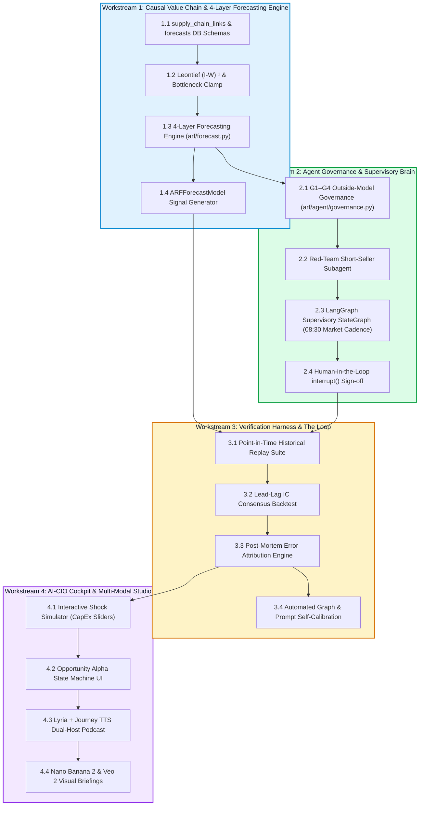
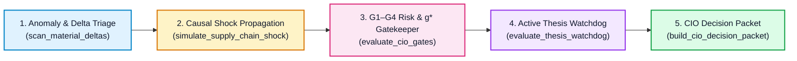

# ARF / AI-CIO Master Development Plan & Execution Roadmap
## From Passive Equity Screener to Autonomous Value-Chain Investment Partner

**Document ID:** `PLAN-2026-Q4-002`  
**Date:** 2026-10-31  
**Status:** Active Master Engineering Plan (Phase 1 Completed & Merged in PR #17; Phase 2 In Progress)  
**Target Repositories:** `ARF` / `AI-CIO` (`arf/`, `webapp/`, `data/`, `config/`, `tests/`) & `ai-hedge-fund` (`hedge_fund/signals/`)  
**Cross-References:** 
- [`docs/ARF_PRD.md`](file:///Users/sheng/Developer/ARF/docs/ARF_PRD.md)
- [`docs/ADR-001 代码优先本体准则`](file:///Users/sheng/Developer/ARF/docs/ADR-001-Next-Gen-Modeling-and-Lightweight-Ontology-for-Agents.md)
- [`docs/ARF_DIGITAL_INVESTMENT_ANALYST_VISION.md`](file:///Users/sheng/Developer/ARF/docs/ARF_DIGITAL_INVESTMENT_ANALYST_VISION.md)
- [`docs/AI_CIO_CONNECTING_THE_DOTS_FINANCIAL_MODELING.md`](file:///Users/sheng/Developer/ARF/docs/AI_CIO_CONNECTING_THE_DOTS_FINANCIAL_MODELING.md)

---

## 1. Executive Summary & Strategic Synthesis

Over the course of recent architectural reviews and research breakthroughs, the target vision for the ARF project has matured from a **passive weekly valuation screener** into an **autonomous, causal buy-side AI-CIO (Chief Investment Officer)**.

### The New Direction: Core Pillars

```
┌────────────────────────────────────────────────────────────────────────────────────────┐
│                               AI-CIO STRATEGIC FOUNDATIONS                             │
├────────────────────────────────────────────────────────────────────────────────────────┤
│ 1. Deterministic Financial Modeling Core (FAST Standards)                             │
│    Probabilistic LLMs are confined to unstructured extraction and orchestration;      │
│    the core calculation engine (accounting identities, DCF g*, debt sweeps) remains   │
│    100% deterministic code with zero arithmetic hallucination.                         │
├────────────────────────────────────────────────────────────────────────────────────────┤
│ 2. 5-Layer Causal Value Chain ("Connecting the Dots")                                  │
│    Equities are modeled as an interconnected network, not isolated tickers:           │
│    • Closed CapEx-to-Revenue circuit (Hyperscaler spend = Supplier revenue).           │
│    • Margin squeeze & pricing power transfer across layers (L1 to L5).                 │
│    • Cross-border dual value chain arbitrage (US vs. China vs. Europe chokepoints).   │
│    • Micro-Leontief shock propagation via the inverse matrix (I - W)⁻¹.               │
├────────────────────────────────────────────────────────────────────────────────────────┤
│ 3. 4-Layer Predictive Forecasting Engine (Moving from Thermometer to Barometer)       │
│    Shifts the system from lagging nowcasts to forward-looking predictive alpha:       │
│    • Layer 1 (1–2Q): Supply-chain revenue/EPS forecast (ĝ_ARF) via Leontief clamp.     │
│    • Layer 2 (2–6W): Sell-side consensus revision velocity (ΔEPS) & herding model.    │
│    • Layer 3 (6–12M): Forward FCF distribution & fair-value price fan (P10/P50/P90).  │
│    • Layer 4 (5–20D): CYQ chip cost concentration & regime breakout probabilities.    │
├────────────────────────────────────────────────────────────────────────────────────────┤
│ 4. Autonomous Dual-Layer Multi-Agent Governance (WoW Pedigree)                         │
│    • Supervisor Governor (LangGraph): Daily market cadence, portfolio drift, human     │
│      interrupt() sign-offs.                                                           │
│    • Specialist Sandboxed Workers (Gemini 3.8 Flash): Supply chain parsing, forensic   │
│      quant auditing, and red-team short-seller cross-examination.                     │
│    • G1–G4 Outside-Model Risk Gates: Code-level circuit breakers ("Guards Must Bite")  │
│      preventing AI from recommending valuation froth or substandard capital returns.   │
├────────────────────────────────────────────────────────────────────────────────────────┤
│ 5. Continuous Improvement Loop ("The Loop" OODA Flywheel)                             │
│    Every quarter, realized earnings are audited against model predictions.            │
│    Errors are automatically decomposed into:                                          │
│      (A) Graph Topology Errors (allocation shifts)                                    │
│      (B) Parameter / BoM Share Errors                                                 │
│      (C) Exogenous Macro Shocks                                                       │
│    Driving automated graph edge recalibration, Brier/RMSE scoring, and prompt tuning. │
└────────────────────────────────────────────────────────────────────────────────────────┘
```

---

## 2. Current Baseline & Engineering Gap Analysis

| Module / Layer | Current Status in Codebase | Engineering Gap to New Direction |
| :--- | :--- | :--- |
| **Data & Storage** | ✅ **Completed (PR #17)**: DuckDB `snapshot_revisions`, `supply_chain_links`, and `forecasts` tables with point-in-time history. | Need persistent storage/tracking for machine-executable `KillCondition` predicates and `CIODecisionPacket` audit logs. |
| **Scoring Engine** | $E$-score, $V$-score, ARF deciles, local-currency reverse-DCF ($g^*$), Froth flag in `arf/scoring.py`. | Missing cross-company reverse-DCF consistency gate (e.g. flagging when Supplier $g^* > 2\times$ Customer $g^*$). |
| **Value Chain & Forecasting** | ✅ **Completed (PR #17)**: `arf/forecast.py` implements 4-layer Barometer (`HORIZON_CONVERGENCE=0.30`, `DEFAULT_BOTTLENECK_CLAMP=0.80`, disjoint 14d/30d revision windows, `_local_market_cap` FX alignment). | Need programmatic event-driven shock propagation (`simulate_supply_chain_shock`) so the CIO agent can run stress tests without a human dragging UI sliders. |
| **Alpha Signals & CIO** | ✅ **Completed (PR #17)**: `ARFForecastModel` in `ai-hedge-fund` (`arf-prod-2026-10-30`) blended with `ARFModel` in `arf/cio.py` using point-in-time `load_forecast_history`. | `arf/cio.py` portfolio replay and `arf/agent/thesis.py` qualitative IDRs are still disconnected; active positions are not monitored against thesis invalidation rules. |
| **Agent & Autonomous CIO Loop** | Pydantic schemas in `arf/agent/schemas.py`, 5-step IDR persistence in `arf/db.py`, Gemini screener. | **Primary Phase 2 Focus**: Build `arf/agent/cio_loop.py` implementing the 5-Stage Autonomous CIO Workflow: Anomaly Delta Triage, Causal Shock Propagation, G1–G4 Gatekeeper, Executable Thesis Watchdog (`KillCondition`), and Push-First `CIODecisionPacket`. |
| **Webapp Cockpit & CLI** | 10 Streamlit pages including the new `🔮 预测晴雨表与前瞻 Alpha` tab in `webapp/pages/10_💼_CIO_投资总监.py`. | Expose the Autonomous CIO Decision Packet & Thesis Watchdog alerts both as a headless CLI/Markdown brief and inside the CIO Cockpit Inbox. |
| **Verification & Loop** | 301 unit tests passing in `ARF` + 8 signal tests in `ai-hedge-fund`. | Add unit tests for `cio_loop.py` (`tests/test_cio_loop.py`) covering executable kill conditions, shock propagation, G1–G4 gates, and decision packet generation. |

---

## 3. Four Core Workstreams



---

## 4. Detailed Implementation Roadmap & Deliverables

### Phase 1: Causal Value Chain, Micro-Leontief & 4-Layer Forecasting Engine (✅ Completed — PR #17)
**Goal:** Transform the 5-layer stack from a static display list into an active calculation graph and forward-looking forecasting system.

* **Task 1.1: DuckDB Schema Migration for `supply_chain_links` and `forecasts` (✅ Done)**
  * Target: `arf/db.py`, `data/arf.db`
  * Deliverable: 
    * `supply_chain_links`: `supplier_ticker`, `customer_ticker`, `revenue_share_pct` ($w_{ij}$), `bom_component_pct` ($\beta$), `relationship_type`, `verified_source`, `last_updated`.
    * `forecasts`: `ticker`, `as_of_date`, `horizon_days`, `predicted_rev_growth` ($\hat{g}_{\text{ARF}}$), `consensus_rev_growth`, `expected_beat_pct`, `eps_surprise_prob`, `fair_value_p10`, `fair_value_p50`, `fair_value_p90`, `regime_breakout_prob`, `model_version`, `created_at`.
* **Task 1.2: Canonical Supply Chain Dependency Seeding (✅ Done)**
  * Target: `arf/forecast.py` (`CANONICAL_SUPPLY_CHAIN_LINKS`, `seed_default_supply_chain_links`)
  * Deliverable: Baseline directed weights ($w_{ij}$) across optical interconnect, foundry/packaging, lithography, cloud hyperscalers, and thermal/power infrastructure.
* **Task 1.3: Deterministic 4-Layer Forecasting Engine (✅ Done)**
  * Target: `arf/forecast.py`
  * Deliverable:
    1. *Layer 1 (Fundamental Forecast):* Supply-chain revenue/EPS forecast $\hat{g}_{\text{ARF}}$, expected beat margin, and `DEFAULT_BOTTLENECK_CLAMP = 0.80`.
    2. *Layer 2 (Revision Velocity):* Disjoint 14d `[-21, -7)` and 30d `[-37, -23)` consensus revision velocity & calibrated EPS surprise probability.
    3. *Layer 3 (Valuation Distribution):* Reporting-currency aligned (`_local_market_cap`) multi-stage DCF forward fair-value distribution ($P_{10}$ Bear, $P_{50}$ Base, $P_{90}$ Bull) with `HORIZON_CONVERGENCE = 0.30`.
    4. *Layer 4 (Microstructure Regime):* CYQ chip concentration ratio and 20-day regime breakout probability.
* **Task 1.4: `ARFForecastModel` Signal Generator & Point-in-Time Replay (✅ Done)**
  * Target: `ai-hedge-fund/hedge_fund/signals/arf_forecast.py`, `arf/cio.py`, `webapp/data.py` (`load_forecast_history`)
  * Deliverable: Forward-looking `AlphaModel` blended into `config/arf-mandate.yaml` and deployed to Cloud Run (`arf-webapp` & `arf-pipeline`).

---

### Phase 2: Autonomous 5-Stage CIO Workflow, Executable Thesis Watchdog & Decision Packets (Weeks 3–4 — Active)
**Goal:** Liberate the CIO from a passive, UI-bound dashboard into an **event-driven, push-first autonomous workflow** that bridges quantitative forecasts, portfolio holdings, G1–G4 governance gates, and machine-executable thesis invalidation.



* **Task 2.1: Structured Schemas for Executable Thesis Watchdog & CIO Decision Packets**
  * Target: `arf/agent/schemas.py`
  * Deliverable: Extend Pydantic schemas with:
    1. `KillCondition`: Machine-executable invalidation rule (`metric`, `operator` in `["<", "<=", ">", ">=", "=="]`, `threshold`, `description`) plus a deterministic `evaluate(metrics: dict) -> tuple[bool, str]` method.
    2. `WatchdogAlert`: Structured alert emitted when a held or watched position breaches a `KillCondition`, hits its $P_{90}$ harvest target, or enters a Froth Flag regime (`ticker`, `alert_type`, `severity`, `triggered_rule`, `current_value`, `recommended_action`).
    3. `ProposalTicket`: Actionable IC trade/research proposal (`ticker`, `name`, `leg`, `layer`, `action` in `["INITIATE_LONG", "ADD_LONG", "TRIM_HARVEST", "EXIT_INVALIDATED", "SHORT_FROTH", "HOLD_MONITOR"]`, `conviction`, `expected_beat_pct`, `eps_surprise_prob`, `expected_return_p50`, `regime_breakout_prob`, `gate_verdict`, `gate_details`, `rationale`, `kill_conditions`).
    4. `CIODecisionPacket`: The complete daily/event-driven CIO briefing (`packet_id`, `as_of_date`, `regime_summary`, `shock_scenario`, `watchdog_alerts`, `proposals`, `markdown_brief`) that can be rendered in CLI, pushed to messaging channels, or displayed in the CIO Cockpit.
* **Task 2.2: Deterministic G1–G4 + Cross-Node $g^*$ Consistency Gatekeeper**
  * Target: `arf/agent/cio_loop.py` (`evaluate_cio_gates`)
  * Deliverable: Pure-Python outside-model risk gates enforcing:
    1. *G1 (Data Integrity):* Price and market cap must be finite and positive.
    2. *G2 (WACC Hurdle Gate):* Blocks long initiation if `roe < wacc` ($10\%$ US, $12\%$ China) when valuation stretch $V \ge 60$.
    3. *G3 (Froth Circuit Breaker):* Hard block on long initiation/addition if `froth_flag is True` (automatically flips recommendation to `SHORT_FROTH` or `EXIT_INVALIDATED`).
    4. *G4 (Supply-Chain Implied Growth $g^*$ Consistency Gate):* Compares supplier reverse-DCF `implied_growth` ($g^*$) against its mapped customers' average `implied_growth`. Flags `BLOCKED_VALUATION_STRETCH` if $\text{Supplier } g^* > 2.0 \times \text{Customer } g^*$ and $\text{Supplier } g^* > 0.25$.
* **Task 2.3: Programmatic Supply-Chain Shock Simulator & Anomaly Delta Triage**
  * Target: `arf/agent/cio_loop.py` (`simulate_supply_chain_shock`, `scan_material_deltas`)
  * Deliverable:
    * `simulate_supply_chain_shock(conn, as_of, customer_shocks: dict[str, float], bottleneck_clamp: float | None = 0.80)`: Propagates arbitrary customer CapEx/revenue growth shocks (e.g., `{"MSFT": 0.15, "META": 0.20}` or `{"AAPL": -0.15}`) through `supply_chain_links`, recomputes supplier `predicted_rev_growth`, `expected_beat_pct`, `eps_surprise_prob`, and `expected_return_p50`, and returns the delta DataFrame.
    * `scan_material_deltas(conn, as_of)`: Identifies high-conviction forward opportunities (`expected_beat_pct >= 0.08`, `expected_return_p50 >= 0.15`, `regime_breakout_prob >= 0.60`) and froth/deterioration hazards across both US and China legs.
* **Task 2.4: Active Thesis Watchdog & Automated Kill-Condition Compiler**
  * Target: `arf/agent/cio_loop.py` (`default_kill_conditions_for_row`, `evaluate_thesis_watchdog`)
  * Deliverable:
    * Automatically attaches default quantitative `KillCondition` predicates to every active position or IDR (e.g., `froth_flag == True`, `roe < wacc * 0.5`, `expected_beat_pct < -0.10`, `chip_profit_ratio < 0.20`), and evaluates all held/monitored tickers against latest snapshot + forecast metrics.
    * Also checks for **Harvest Triggers** when price approaches or exceeds `fair_value_p90` (`expected_return_p50 <= -0.05` after rally).
* **Task 2.5: Headless CLI Entrypoint & CIO Cockpit Inbox Integration**
  * Target: `arf/agent/cio_loop.py` (`python -m arf.agent.cio_loop --as-of YYYY-MM-DD [--shock TICKER:DELTA ...]`), `webapp/pages/10_💼_CIO_投资总监.py`
  * Deliverable:
    * CLI tool that generates and prints the Markdown `CIODecisionPacket` on demand or in scheduled jobs.
    * Integration into `webapp/pages/10_💼_CIO_投资总监.py` so the PM can view the pushed **📬 CIO 决策简报与持仓哨兵 (Autonomous CIO Decision Packet & Thesis Watchdog)**, run conversational/preset shock scenarios, and inspect G1–G4 gate verdicts and kill conditions.

---

### Phase 3: The Continuous Improvement Loop & Verification Harness (Weeks 5–6)
**Goal:** Establish the self-calibrating feedback loop and empirical backtesting suite.

* **Task 3.1: Point-in-Time Historical Replay Suite**
  * Target: `tests/test_replay.py`, `arf/backtest.py`
  * Deliverable: Replay engine querying `snapshot_revisions` to verify factor stability and eliminate lookahead bias across 2024–2026 test windows.
* **Task 3.2: Lead-Lag Consensus Revision Predictability Test**
  * Target: `arf/strategy/lead_lag.py`
  * Deliverable: Compute Information Coefficient ($\text{IC}$) measuring how accurately customer CapEx announcements predict supplier earnings revisions $30\text{–}60$ days later. Target: $\text{IC} \ge 0.08$.
* **Task 3.3: Post-Mortem Error Attribution Engine**
  * Target: `arf/agent/postmortem.py`
  * Deliverable: Automated quarterly audit comparing realized filings against predicted revenues:
    $$\epsilon = \text{Realized} - \text{Predicted}$$
    Decompose $\epsilon$ into Category A (Topology Shift), Category B (BoM Error), and Category C (Macro/FX Shock).
* **Task 3.4: Automated Graph & Prompt Self-Calibration**
  * Target: `arf/agent/tuning.py`
  * Deliverable: Updates edge weights $w_{ij}$ in DuckDB when allocation shifts occur; leverages failure cases as negative few-shot examples for specialist prompts.

---

### Phase 4: AI-CIO Executive Cockpit & Multi-Modal Studio (Weeks 7–8)
**Goal:** Deliver the executive user experience for the portfolio manager and investment committee.

* **Task 4.1: Interactive Value-Chain Shock Simulator**
  * Target: `webapp/pages/10_💼_CIO_投资总监.py` & `webapp/pages/8_⚖️_双价值链.py`
  * Deliverable: Dynamic UI slider (e.g. *"Hyperscaler CapEx Revision: -20%"*) recalculating the Leontief matrix in real time and highlighting vulnerable nodes.
* **Task 4.2: Opportunity Alpha Pipeline Board**
  * Target: `webapp/pages/9_🤖_AI_投资雷达.py`
  * Deliverable: Interactive Kanban board tracking theses through the 7 lifecycle stages with one-click CIO approval buttons (`interrupt()` resume).
* **Task 4.3: 2-Host Investment Committee Podcast**
  * Target: `arf/agent/multimodal/audio.py`
  * Deliverable: NotebookLM-style 3-minute audio debrief (Journey Voice F as Growth Analyst vs Journey Voice D as Risk Officer with Lyria ambient music bed).
* **Task 4.4: Automated Visual Slide & Video Briefings**
  * Target: `arf/agent/multimodal/visual.py`
  * Deliverable: One-click 16:9 infographic generation via Nano Banana 2 and 60-second video briefing prompts for Veo 2.

---

## 5. Definition of Done (DoD) & Verification Matrix

| Milestone | Key Verification Metric | Acceptance Criteria |
| :--- | :--- | :--- |
| **Phase 1: Value Chain & Forecaster** | Arithmetic Precision, Conservation & Forecast Bounds | $\sum \Delta \text{Revenue}_{\text{Tier-1}} \le \sum \Delta \text{CapEx}_{\text{Hyperscalers}}$; Zero matrix inversion errors; 100% of generated forecasts produce bounded fair value distributions ($P_{10} \le P_{50} \le P_{90}$) and calibrated beat probabilities $\in [0, 1]$. |
| **Phase 2: Governance** | G3 Gate Integrity ("Guards Must Bite") | 100% of froth-flagged tickers blocked; zero long promotions without explicit quantitative invalidation criteria. |
| **Phase 3: The Loop** | Predictive Power & Attribution | $\text{IC} \ge 0.08$ on 45-day forward analyst consensus revisions; 100% of quarterly earnings forecast deviations classified into A/B/C buckets; Brier score $< 0.25$ on consensus beat predictions. |
| **Phase 4: Cockpit** | End-to-End PM Latency | Real-time Leontief shock recalculation $< 500\text{ ms}$; multi-modal debriefs generated on demand. |

---

## 6. Execution Timeline & Governance

```
Week:    W1   W2   W3   W4   W5   W6   W7   W8
Phase 1: [=========]
Phase 2:           [=========]
Phase 3:                     [=========]
Phase 4:                               [=========]
```

* **Weekly Cadence:** Every Monday 09:00 CST pipeline snapshot verification.
* **Quarterly Reset:** Post-earnings season error attribution audit and value-chain weight recalibration.
* **Living Document Mandate:** This development plan is updated incrementally as empirical feedback arrives from live paper trading and backtest calibrations.

