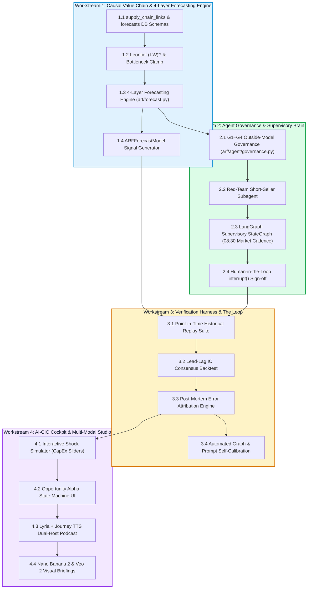

# ARF / AI-CIO Master Development Plan & Execution Roadmap
## From Passive Equity Screener to Autonomous Value-Chain Investment Partner

**Document ID:** `PLAN-2026-Q4-001`  
**Date:** 2026-10-29  
**Status:** Approved Master Engineering Plan  
**Target Repositories:** `ARF` / `AI-CIO` (`arf/`, `webapp/`, `data/`, `config/`, `tests/`)  
**Cross-References:** 
- [`docs/ARF_PRD.md`](file:///Users/sheng/Developer/ARF/docs/ARF_PRD.md)
- [`docs/ADR-001 代码优先本体准则`](file:///Users/sheng/Developer/ARF/docs/ADR-001-Next-Gen-Modeling-and-Lightweight-Ontology-for-Agents.md)
- [`docs/ARF_DIGITAL_INVESTMENT_ANALYST_VISION.md`](file:///Users/sheng/Developer/ARF/docs/ARF_DIGITAL_INVESTMENT_ANALYST_VISION.md)
- [`docs/AI_CIO_CONNECTING_THE_DOTS_FINANCIAL_MODELING.md`](file:///Users/sheng/Developer/ARF/docs/AI_CIO_CONNECTING_THE_DOTS_FINANCIAL_MODELING.md)

---

## 1. Executive Summary & Strategic Synthesis

Over the course of recent architectural reviews and research breakthroughs, the target vision for the ARF project has matured from a **passive weekly valuation screener** into an **autonomous, causal buy-side AI-CIO (Chief Investment Officer)**.

### The New Direction: Core Pillars

```
┌────────────────────────────────────────────────────────────────────────────────────────┐
│                               AI-CIO STRATEGIC FOUNDATIONS                             │
├────────────────────────────────────────────────────────────────────────────────────────┤
│ 1. Deterministic Financial Modeling Core (FAST Standards)                             │
│    Probabilistic LLMs are confined to unstructured extraction and orchestration;      │
│    the core calculation engine (accounting identities, DCF g*, debt sweeps) remains   │
│    100% deterministic code with zero arithmetic hallucination.                         │
├────────────────────────────────────────────────────────────────────────────────────────┤
│ 2. 5-Layer Causal Value Chain ("Connecting the Dots")                                  │
│    Equities are modeled as an interconnected network, not isolated tickers:           │
│    • Closed CapEx-to-Revenue circuit (Hyperscaler spend = Supplier revenue).           │
│    • Margin squeeze & pricing power transfer across layers (L1 to L5).                 │
│    • Cross-border dual value chain arbitrage (US vs. China vs. Europe chokepoints).   │
│    • Micro-Leontief shock propagation via the inverse matrix (I - W)⁻¹.               │
├────────────────────────────────────────────────────────────────────────────────────────┤
│ 3. 4-Layer Predictive Forecasting Engine (Moving from Thermometer to Barometer)       │
│    Shifts the system from lagging nowcasts to forward-looking predictive alpha:       │
│    • Layer 1 (1–2Q): Supply-chain revenue/EPS forecast (ĝ_ARF) via Leontief clamp.     │
│    • Layer 2 (2–6W): Sell-side consensus revision velocity (ΔEPS) & herding model.    │
│    • Layer 3 (6–12M): Forward FCF distribution & fair-value price fan (P10/P50/P90).  │
│    • Layer 4 (5–20D): CYQ chip cost concentration & regime breakout probabilities.    │
├────────────────────────────────────────────────────────────────────────────────────────┤
│ 4. Autonomous Dual-Layer Multi-Agent Governance (WoW Pedigree)                         │
│    • Supervisor Governor (LangGraph): Daily market cadence, portfolio drift, human     │
│      interrupt() sign-offs.                                                           │
│    • Specialist Sandboxed Workers (Gemini 3.8 Flash): Supply chain parsing, forensic   │
│      quant auditing, and red-team short-seller cross-examination.                     │
│    • G1–G4 Outside-Model Risk Gates: Code-level circuit breakers ("Guards Must Bite")  │
│      preventing AI from recommending valuation froth or substandard capital returns.   │
├────────────────────────────────────────────────────────────────────────────────────────┤
│ 5. Continuous Improvement Loop ("The Loop" OODA Flywheel)                             │
│    Every quarter, realized earnings are audited against model predictions.            │
│    Errors are automatically decomposed into:                                          │
│      (A) Graph Topology Errors (allocation shifts)                                    │
│      (B) Parameter / BoM Share Errors                                                 │
│      (C) Exogenous Macro Shocks                                                       │
│    Driving automated graph edge recalibration, Brier/RMSE scoring, and prompt tuning. │
└────────────────────────────────────────────────────────────────────────────────────────┘
```

---

## 2. Current Baseline & Engineering Gap Analysis

| Module / Layer | Current Status in Codebase | Engineering Gap to New Direction |
| :--- | :--- | :--- |
| **Data & Storage** | DuckDB `snapshot_revisions`, versioned Parquet data lake on GCS (`arf-data-ai-rf`), hybrid China proxy. | Missing persistent `supply_chain_links` table in DuckDB to store customer concentration weights ($w_{ij}$) and `forecasts` table to log multi-horizon predictions. |
| **Scoring Engine** | $E$-score, $V$-score, ARF deciles, local-currency reverse-DCF ($g^*$), Froth flag in `arf/scoring.py`. | Scoring treats each firm independently; missing cross-company consistency checks (e.g. Supplier $g^* > 2\times$ Customer $g^*$) and forward-looking growth forecasts. |
| **Value Chain & Forecasting** | `config/value_chain.yaml` + `arf/value_chain.py` tracks market-cap snapshots across 5 layers. | Value chain is currently a static hierarchy, not an active directed graph. Completely missing `arf/forecast.py` to forecast revenue surprises, revision velocity, and forward fair values. |
| **Alpha Signals & CIO** | `ARFModel` in `ai-hedge-fund` trades static $(E - V)/100$ factor spreads; `arf/cio.py` replays mandate. | Alpha signals react after trailing fundamentals update; missing `ARFForecastModel` trading on forward expected surprise ($\hat{g}_{\text{ARF}} - g_{\text{Consensus}}$) and upside to $P_{50}$. |
| **Agent & IDR** | Pydantic schemas in `arf/agent/schemas.py`, 5-step IDR persistence in `arf/db.py`, Gemini screener. | Missing dedicated outside-model `arf/agent/governance.py` (G3 gates), LangGraph supervisor graph, and Red-Team adversarial debater. |
| **Webapp Cockpit** | 10 Streamlit pages (Bubble thermometer, Dual Value Chain, CIO Cockpit replaying `ai-hedge-fund`). | Cockpit lacks interactive value-chain shock simulator (e.g., CapEx slider) and Opportunity Alpha stage lifecycle management. |
| **Verification & Loop** | Unit tests for scoring, database, and fetchers (>80% coverage in `tests/`). | Missing forecast calibration scorecard (Brier score, RMSE, lead-lag $\text{IC}$) and automated post-mortem quarterly error attribution. |

---

## 3. Four Core Workstreams



---

## 4. Detailed Implementation Roadmap & Deliverables

### Phase 1: Causal Value Chain, Micro-Leontief & 4-Layer Forecasting Engine (Weeks 1–2)
**Goal:** Transform the 5-layer stack from a static display list into an active calculation graph and forward-looking forecasting system.

* **Task 1.1: DuckDB Schema Migration for `supply_chain_links` and `forecasts`**
  * Target: `arf/db.py`, `data/arf.db`
  * Deliverable: 
    * `supply_chain_links`: `supplier_ticker`, `customer_ticker`, `revenue_share_pct` ($w_{ij}$), `bom_component_pct` ($\beta$), `relationship_type`, `verified_source`, `last_updated`.
    * `forecasts`: `ticker`, `as_of_date`, `horizon_days`, `predicted_rev_growth` ($\hat{g}_{\text{ARF}}$), `consensus_rev_growth`, `expected_beat_pct`, `eps_surprise_prob`, `fair_value_p10`, `fair_value_p50`, `fair_value_p90`, `regime_breakout_prob`, `model_version`, `created_at`.
* **Task 1.2: Supply Chain Traversal & Dependency Matrix Initialization**
  * Target: `arf/agent/traversal.py`, `config/value_chain.yaml`
  * Deliverable: Ingest customer concentration disclosures from 10-K / annual reports to establish baseline directed weights ($w_{ij}$) across the 73-stock universe.
* **Task 1.3: Micro-Leontief $(I - W)^{-1}$ Solver with Bottleneck Capacity Clamps**
  * Target: `arf/value_chain.py`
  * Deliverable: In-memory `networkx.DiGraph` representing the 5 layers. Propagates downstream CapEx revisions upstream, constrained by physical manufacturing and packaging bottlenecks:
    $$\Delta \text{Revenue}_{\text{Predicted}} = \min\left( (I - W)^{-1} \cdot \Delta \text{CapEx}_{\text{Hyperscalers}}, \; \text{Bottleneck Capacity} \right)$$
* **Task 1.4: Deterministic 4-Layer Forecasting Engine (`arf/forecast.py`)**
  * Target: `arf/forecast.py`
  * Deliverable:
    1. *Layer 1 (Fundamental Forecast):* Compute supply-chain revenue/EPS forecast $\hat{g}_{\text{ARF}}$ and expected beat margin.
    2. *Layer 2 (Revision Velocity):* Compute consensus revision acceleration ($\Delta \text{EPS}_{14d/30d}$) & cross-node PEAD spillover.
    3. *Layer 3 (Valuation Distribution):* Model operating leverage and multi-stage DCF forward fair-value distribution ($P_{10}$ Bear, $P_{50}$ Base, $P_{90}$ Bull).
    4. *Layer 4 (Microstructure Regime):* CYQ chip concentration ratio and 20-day regime breakout probability.
* **Task 1.5: `ARFForecastModel` Signal Generator for `ai-hedge-fund` / `arf/cio.py`**
  * Target: `ai-hedge-fund/hedge_fund/signals/arf_forecast.py`, `arf/cio.py`
  * Deliverable: Forward-looking `AlphaModel` generating signals based on expected earnings surprise ($\hat{g}_{\text{ARF}} - g_{\text{Consensus}}$) and expected upside to $P_{50}$, testable in `aihf backtest` and the CIO Cockpit.

---

### Phase 2: Outside-Model G3 Governance & Supervisory LangGraph (Weeks 3–4)
**Goal:** Implement outside-model capital guardrails and the autonomous supervisory pulse.

* **Task 2.1: Deterministic G1–G4 Risk Module**
  * Target: `arf/agent/governance.py`
  * Deliverable: Python predicates enforcing:
    1. *Bubble / Froth Gate:* Blocks long recommendations on froth-flagged names.
    2. *Hurdle Rate Gate:* Enforces $\text{ROE} \ge \text{WACC}$ ($10\%$ US, $12\%$ China).
    3. *Invalidation Rigor Gate:* Disqualifies theses lacking quantitative stop-loss / invalidation criteria.
* **Task 2.2: Adversarial Red-Team Short-Seller Subagent**
  * Target: `arf/agent/redteam.py`
  * Deliverable: Parallel agent that challenges bull theses by searching for ASIC substitution, customer concentration, and margin compression risks.
* **Task 2.3: LangGraph Supervisory StateGraph**
  * Target: `arf/agent/supervisor/graph.py`
  * Deliverable: Autonomous workflow orchestrator:
    `scan_market_anomalies` $\rightarrow$ `evaluate_drift` $\rightarrow$ `dispatch_specialists` $\rightarrow$ `synthesize_thesis` $\rightarrow$ `mechanical_risk_gate (G3)` $\rightarrow$ `human_pm_interrupt()`.
* **Task 2.4: Opportunity Alpha State Machine Engine**
  * Target: `arf/agent/schemas.py`, `arf/db.py`
  * Deliverable: Formal state transitions: `discovered` $\rightarrow$ `quant_qualified` $\rightarrow$ `deliberating` $\rightarrow$ `thesis_formulated` $\rightarrow$ `committee_gate` $\rightarrow$ `active_watch` $\rightarrow$ `harvested` / `invalidated`.

---

### Phase 3: The Continuous Improvement Loop & Verification Harness (Weeks 5–6)
**Goal:** Establish the self-calibrating feedback loop and empirical backtesting suite.

* **Task 3.1: Point-in-Time Historical Replay Suite**
  * Target: `tests/test_replay.py`, `arf/backtest.py`
  * Deliverable: Replay engine querying `snapshot_revisions` to verify factor stability and eliminate lookahead bias across 2024–2026 test windows.
* **Task 3.2: Lead-Lag Consensus Revision Predictability Test**
  * Target: `arf/strategy/lead_lag.py`
  * Deliverable: Compute Information Coefficient ($\text{IC}$) measuring how accurately customer CapEx announcements predict supplier earnings revisions $30\text{–}60$ days later. Target: $\text{IC} \ge 0.08$.
* **Task 3.3: Post-Mortem Error Attribution Engine**
  * Target: `arf/agent/postmortem.py`
  * Deliverable: Automated quarterly audit comparing realized filings against predicted revenues:
    $$\epsilon = \text{Realized} - \text{Predicted}$$
    Decompose $\epsilon$ into Category A (Topology Shift), Category B (BoM Error), and Category C (Macro/FX Shock).
* **Task 3.4: Automated Graph & Prompt Self-Calibration**
  * Target: `arf/agent/tuning.py`
  * Deliverable: Updates edge weights $w_{ij}$ in DuckDB when allocation shifts occur; leverages failure cases as negative few-shot examples for specialist prompts.

---

### Phase 4: AI-CIO Executive Cockpit & Multi-Modal Studio (Weeks 7–8)
**Goal:** Deliver the executive user experience for the portfolio manager and investment committee.

* **Task 4.1: Interactive Value-Chain Shock Simulator**
  * Target: `webapp/pages/10_💼_CIO_投资总监.py` & `webapp/pages/8_⚖️_双价值链.py`
  * Deliverable: Dynamic UI slider (e.g. *"Hyperscaler CapEx Revision: -20%"*) recalculating the Leontief matrix in real time and highlighting vulnerable nodes.
* **Task 4.2: Opportunity Alpha Pipeline Board**
  * Target: `webapp/pages/9_🤖_AI_投资雷达.py`
  * Deliverable: Interactive Kanban board tracking theses through the 7 lifecycle stages with one-click CIO approval buttons (`interrupt()` resume).
* **Task 4.3: 2-Host Investment Committee Podcast**
  * Target: `arf/agent/multimodal/audio.py`
  * Deliverable: NotebookLM-style 3-minute audio debrief (Journey Voice F as Growth Analyst vs Journey Voice D as Risk Officer with Lyria ambient music bed).
* **Task 4.4: Automated Visual Slide & Video Briefings**
  * Target: `arf/agent/multimodal/visual.py`
  * Deliverable: One-click 16:9 infographic generation via Nano Banana 2 and 60-second video briefing prompts for Veo 2.

---

## 5. Definition of Done (DoD) & Verification Matrix

| Milestone | Key Verification Metric | Acceptance Criteria |
| :--- | :--- | :--- |
| **Phase 1: Value Chain & Forecaster** | Arithmetic Precision, Conservation & Forecast Bounds | $\sum \Delta \text{Revenue}_{\text{Tier-1}} \le \sum \Delta \text{CapEx}_{\text{Hyperscalers}}$; Zero matrix inversion errors; 100% of generated forecasts produce bounded fair value distributions ($P_{10} \le P_{50} \le P_{90}$) and calibrated beat probabilities $\in [0, 1]$. |
| **Phase 2: Governance** | G3 Gate Integrity ("Guards Must Bite") | 100% of froth-flagged tickers blocked; zero long promotions without explicit quantitative invalidation criteria. |
| **Phase 3: The Loop** | Predictive Power & Attribution | $\text{IC} \ge 0.08$ on 45-day forward analyst consensus revisions; 100% of quarterly earnings forecast deviations classified into A/B/C buckets; Brier score $< 0.25$ on consensus beat predictions. |
| **Phase 4: Cockpit** | End-to-End PM Latency | Real-time Leontief shock recalculation $< 500\text{ ms}$; multi-modal debriefs generated on demand. |

---

## 6. Execution Timeline & Governance

```
Week:    W1   W2   W3   W4   W5   W6   W7   W8
Phase 1: [=========]
Phase 2:           [=========]
Phase 3:                     [=========]
Phase 4:                               [=========]
```

* **Weekly Cadence:** Every Monday 09:00 CST pipeline snapshot verification.
* **Quarterly Reset:** Post-earnings season error attribution audit and value-chain weight recalibration.
* **Living Document Mandate:** This development plan is updated incrementally as empirical feedback arrives from live paper trading and backtest calibrations.

