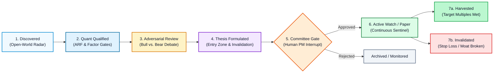
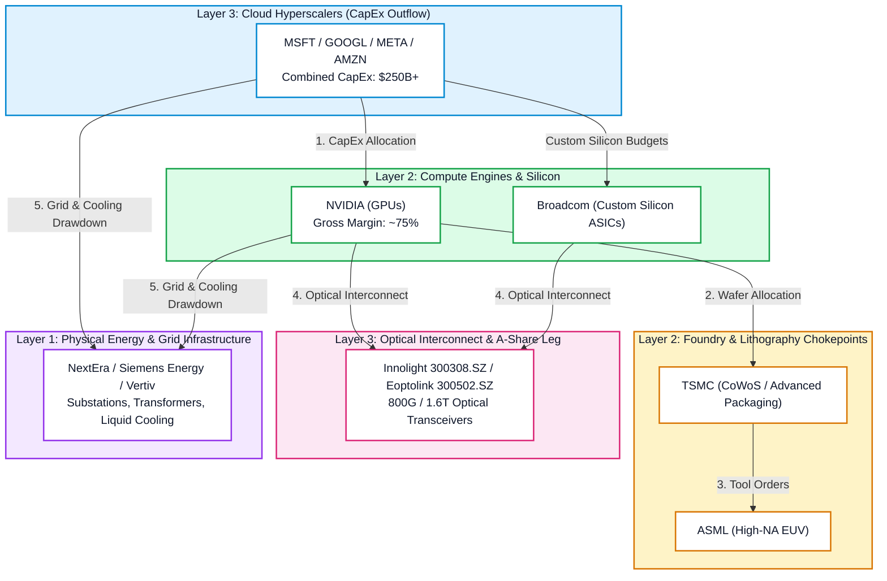
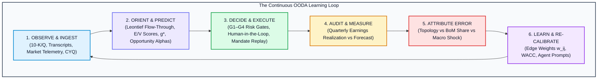

# ARF Digital Investment Analyst & Autonomous AI-CIO
## Product Vision, Multi-Agent Architecture, Value Chain Transmission & The Continuous Improvement Loop

**Date:** 2026-10-28  
**Status:** Approved Strategic Vision & System Architecture Specification  
**Target:** `ARF` / `AI-CIO` (`arf/agent/`, `arf/scoring.py`, `arf/db.py`, `arf/cio.py`, `arf/value_chain.py`, `webapp/`)  
**Context:** Autonomous Buy-Side AI-CIO, Digital Investment Colleague, 5-Layer Supply Chain Discovery Engine, Causal Financial Modeling  
**Architectural Pedigree:** Adapted from the Enterprise AI Project Manager Governance Platform (`WoW` / `wow-ai-pm`) & `ADR-001` (Code-First Operational Ontology)

---

## 1. Executive Summary: The Paradigm Shift

Modern quantitative and equity research tools remain fundamentally **passive and reactive**: they store historical snapshots, compute formulaic scores, render static charts, and wait for human analysts to run manual screens or query conversational chatbots. 

Furthermore, generic AI chat interfaces analyze companies as **isolated corporate silos**—generating a standalone memo on Nvidia, an isolated note on Microsoft, or a disconnected report on Innolight (300308.SZ). In doing so, they miss the fundamental reality of modern industrial revolutions:

> **Companies in the AI economy do not exist in isolation. They are interconnected nodes in a closed, physical and financial circuit where one company's capital expenditure is another company's top-line revenue, and where upstream supply bottlenecks govern downstream software returns.**

This document establishes the strategic vision and architectural blueprint to transform **ARF (AI Relevance Factor)** into an autonomous, proactive **Digital Investment Partner & Research Analyst (Digital Employee / AI-CIO)**.

```
       CONVENTIONAL ARF (Static)                    AUTONOMOUS ARF (Digital AI-CIO)
┌──────────────────────────────────────┐     ┌──────────────────────────────────────────────────┐
│ • Weekly batch pipeline              │     │ • 24/7 autonomous market cadence & telemetry     │
│ • Static 73-stock coverage universe  │     │ • Open-World AI supply chain exploration         │
│ • Formulaic E and V factor percentiles│ ──▶ │ • Multi-agent Bull vs. Bear adversarial research │
│ • Reactive Streamlit dashboards      │     │ • G1–G4 outside-model deterministic risk gates   │
│ • Isolated single-stock analysis     │     │ • 5-Layer Causal Value Chain Transmission Engine │
│ • Manual report exports              │     │ • Closed-loop backtesting & self-improving loop  │
└──────────────────────────────────────┘     │ • Grounded NotebookLM citations & audio debriefs │
                                             └──────────────────────────────────────────────────┘
```

By borrowing the battle-tested multi-agent supervisory patterns from **WoW** (`wow-ai-pm`) and the domain modeling standards of [`ADR-001`](file:///Users/sheng/Developer/ARF/docs/ADR-001-Next-Gen-Modeling-and-Lightweight-Ontology-for-Agents.md), ARF separates **macro supervisory orchestration** from **specialist task execution**, enforces **outside-model mechanical risk gates**, and tracks ideas through a formal **living state machine**.

---

## 2. Core Concepts: The Investment Meta-Model

Following the foundational ontology of the WoW Governance Engine, the Digital Investment Analyst is governed by five core pillars:

```
┌──────────────────────────────────────────────────────────────────────────────────────────────┐
│                                  ARF INVESTMENT META-MODEL                                   │
├──────────────────────────┬───────────────────────────┬───────────────────────────────────────┤
│ 1. Opportunity Alpha     │ 2. Dual-Layer Execution   │ 3. Deterministic G1–G4 Governance     │
│    Living state machine  │    Supervisor orchestrator│    Outside-model financial guardrails │
│    tracking idea from    │    vs. sandboxed worker   │    where LLMs cannot talk themselves  │
│    discovery to harvest  │    subagent specialists   │    past capital constraints           │
├──────────────────────────┼───────────────────────────┴───────────────────────────────────────┤
│ 4. 5-Layer Causal Mesh   │ 5. Continuous Improvement Loop (The Flywheel)                     │
│    Connecting dots via   │    Closed-loop OODA error attribution (Graph Topology, BoM Share, │
│    Leontief & CapEx flow │    Macro Shock) driving automated edge re-calibration             │
└──────────────────────────┴───────────────────────────────────────────────────────────────────┘
```

### 2.1 The "Opportunity Alpha" Lifecycle

In WoW, an **Alpha** is an entity whose progress is tracked across ordered, verifiable states. In ARF, an investment thesis is never a static row in a spreadsheet; it is an **Opportunity Alpha** progressing through strict stage gates:



| Lifecycle State | Description | Transition Gate |
|---|---|---|
| **1. Discovered** | Unmapped supplier or beneficiary identified via web search / supply-chain radar | Layer matched (L1–L5), ticker verified in public exchange |
| **2. Quant Qualified** | Automated factor profile computed ($E$ score, $V$ score, ARF decile, ROE, reverse-DCF $g^*$) | Hard G3 gate: $\text{ROE} \ge \text{WACC}$, not froth-flagged |
| **3. Adversarial Review** | Parallel specialist agents conduct forensic accounting and Red-Team cross-examination | Minimum 2 verifiable primary sources cited per claim |
| **4. Thesis Formulated** | Opportunity Card compiled with numerical Valuation Entry Zone and Invalidation Criteria | Quantitative entry zone and structural invalidation defined |
| **5. Committee Gate** | LangGraph `interrupt()` pauses execution for human Fund Manager / CIO review | Human portfolio manager explicit sign-off |
| **6. Active Watch** | Daily sentinel monitors real-time market telemetry, chip profit ratios, and factor drift | Price within entry zone, volume and CYQ support intact |
| **7. Harvested / Invalidated** | Position reaches target multiple or triggers structural thesis invalidation | Automatic post-mortem log and retrospective analysis |

---

## 3. The 5-Layer Value Chain Transmission Engine ("Connecting the Dots")

As established in [`docs/AI_CIO_CONNECTING_THE_DOTS_FINANCIAL_MODELING.md`](file:///Users/sheng/Developer/ARF/docs/AI_CIO_CONNECTING_THE_DOTS_FINANCIAL_MODELING.md), our 73-stock coverage universe across the US and China legs (`config/universe.yaml`, `config/value_chain.yaml`) is modeled as an integrated network:



### 3.1 Four Core Financial Transmission Mechanisms
1. **The CapEx-to-Revenue Closed Circuit:** Enforces cash flow conservation:
   $$\sum \text{CapEx}_{\text{Hyperscalers (L3)}} \times \alpha_{\text{AI Infrastructure \%}} \times \beta_{\text{BoM Component \%}} \equiv \text{Revenue}_{\text{NVDA / AVGO (L2)}}$$
2. **Margin Transfer & Pricing Power Squeeze:** Tracks whether cost inflation (wafer price hikes, electricity tariff increases) is absorbed or passed downstream. If enterprise software seats (L5) cannot monetize AI at scale, margins become compressed in Layer 3, while monopolistic Layer 2 silicon and Layer 1 utilities capture economic rents.
3. **Cross-Border Dual Value Chain Arbitrage:** Models the systemic interdependence between the US stack (Meta, Google, Nvidia) and the China stack (Innolight optical transceivers, SMIC foundry, Huawei/Cambricon domestic accelerators) and Europe's physical monopolies (ASML, Siemens Energy).
4. **Reverse-DCF Growth Harmonization ($g^*$ Consistency):** Compares market-implied growth rates ($g^*$) across layers. If upstream chipmakers imply 38% CAGR while downstream customers imply only 12% CAGR, the model flags systemic valuation froth.

---

## 4. Dual-Layer Multi-Agent Architecture

WoW established the critical distinction between **Supervisor (Governor)** and **Work Package Owner (Specialist Worker)**. Applying this to quantitative equity research:

```
┌────────────────────────────────────────────────────────────────────────────────────────┐
│ 1. USER COCKPIT & COLLABORATIVE WORKSPACE (Streamlit / Next.js)                        │
│    Opportunity Pipeline · Thermal Bubble Gauge · Factor Decomposition · Audio Briefing  │
├────────────────────────────────────────────────────────────────────────────────────────┤
│ 2. INVESTMENT SUPERVISORY BRAIN (LangGraph StateGraph - arf/agent/supervisor/)         │
│    • Daily Scan (GARP, Breakouts, Froth) ──▶ Tolerance & Entry Zone Check              │
│    • Adversarial Deliberation Synthesis ──▶ G3 Mechanical Risk Gate                    │
│    • Human-in-the-Loop interrupt() ──▶ CIO Sign-off on Staging & Universe Promotion    │
├────────────────────────────────────────────────────────────────────────────────────────┤
│ 3. SPECIALIST RESEARCH WORKERS (Sandboxed Subagents - Gemini 3.8 Flash)                │
│    • Supply Chain Traversal Agent (10-K disclosures, customer-supplier graphs)          │
│    • Forensic Quant Agent (Reverse-DCF sensitivity, 扣非 net profit ROE, FX audit)      │
│    • Red-Team Short Seller (ASIC substitution risk, hyperscaler capex deceleration)     │
├────────────────────────────────────────────────────────────────────────────────────────┤
│ 4. DOMAIN REPOSITORY & PROVENANCE KERNEL (DuckDB / Cloud SQL)                          │
│    Single Source of Truth: snapshots · candidate_pool · investment_theses · telemetry  │
└────────────────────────────────────────────────────────────────────────────────────────┘
```

### 4.1 Specialist Worker Agents
1. **Supply Chain Traversal Agent:**
   - *Mission:* Maps customer-supplier dependencies across the 5 layers.
   - *Tools:* Google Search, SEC EDGAR 10-K Item 1 parser, CapEx tracker.
   - *Output:* Verified key customers, estimated AI revenue percentage (pure-play %), and customer concentration weights ($w_{ij}$).
2. **Forensic Quant & Valuation Agent:**
   - *Mission:* Conducts rigorous financial audits using local reporting currencies.
   - *Tools:* Reverse-DCF solver (`implied_growth`), 扣非 (after non-recurring) ROE calculation, FX normalization.
   - *Output:* Implied growth rate $g^*$, growth gap vs consensus, historical EV/Sales percentile.
3. **Red-Team Short-Seller Agent:**
   - *Mission:* Adversarially challenges every proposed bull thesis.
   - *Tools:* Financial statement anomaly scanner, ASIC substitution risk analyzer, margin compression monitor.
   - *Output:* Verifiable invalidation criteria (e.g. *"Gross margin drops below 55%"*, *"Loss of tier-1 optical transceiver allocation"*), bear-case probability, and downside valuation floor.

---

## 5. Deterministic Governance Guarantees (G1–G4) for Capital

In generative AI, hallucinations in creative writing are harmless; in asset management, hallucinations cause catastrophic capital impairment. ARF implements WoW's **Governance Guarantees**:

```
┌────────────────────────────────────────────────────────────────────────────────────────┐
│                              G1–G4 GOVERNANCE GUARANTEES                               │
├────────────────────────────────────────────────────────────────────────────────────────┤
│ G1: Witnessed Mutation · Every thesis change, entry zone adjustment, or portfolio      │
│     promotion is logged with timestamp, model identifier, and rationale.               │
├────────────────────────────────────────────────────────────────────────────────────────┤
│ G2: Data Provenance · Every claim must cite verified primary data (SEC filing,         │
│     AkShare financial statement, or verified earnings transcript).                     │
├────────────────────────────────────────────────────────────────────────────────────────┤
│ G3: Outside-Model Circuit Breaker · Deterministic Python predicates enforce financial   │
│     sanity. An LLM cannot talk itself into recommending a bubble.                      │
├────────────────────────────────────────────────────────────────────────────────────────┤
│ G4: Dual-Grade Authority · Agent touch_grade (research/query) is separate from         │
│     commit_grade (capital allocation / core universe admission).                        │
└────────────────────────────────────────────────────────────────────────────────────────┘
```

### 5.1 The G3 Mechanical Risk Gate (Code-Level Predicate)
```python
def mechanical_risk_gate(profile: dict[str, Any], thesis: dict[str, Any]) -> GovernanceResult:
    """Deterministic outside-model risk gate. Executes independently of LLM reasoning."""
    # 1. Bubble & Froth Guardrail
    if profile.get("froth_flag") is True and thesis.get("thesis_type") == "long_opportunity":
        return GovernanceResult(
            passed=False, 
            verdict="BLOCKED_BY_G3",
            reason="G3 Gate: Target is froth-flagged (ARF in D1, ROE < WACC, P/S > 25)."
        )

    # 2. Capital Return Guardrail for GARP
    cost_of_equity = 0.10 if profile.get("leg") == "US" else 0.12
    if thesis.get("thesis_type") == "garp_value" and profile.get("roe", 0) < cost_of_equity:
        return GovernanceResult(
            passed=False,
            verdict="BLOCKED_BY_G3",
            reason=f"G3 Gate: ROE ({profile.get('roe'):.1%}) fails hurdle rate ({cost_of_equity:.1%})."
        )

    # 3. Explicit Invalidation Requirement
    if not thesis.get("invalidation_criteria") or len(thesis["invalidation_criteria"]) < 20:
        return GovernanceResult(
            passed=False,
            verdict="BLOCKED_BY_G3",
            reason="G3 Gate: Opportunity Card lacks verifiable, quantitative invalidation criteria."
        )

    return GovernanceResult(passed=True, verdict="PASSED")
```

---

## 6. How We Verify the Model and Continuously Improve It: "The Loop"

A quantitative investment architecture is only as good as its verification rigor and adaptation feedback. We reject black-box statistical fitting in favor of a **deterministic, causal verification framework** paired with a **closed-loop active learning flywheel**.



### 6.1 The 5 Dimensions of Model Verification

To guarantee that the model reflects reality and avoids spurious correlations:

1. **Point-in-Time Historical Replay (Zero Lookahead Bias):**
   * Stored in DuckDB (`snapshot_revisions`), readers query only historical revisions as of date $T$.
   * Replays verify whether a factor profile generated in June 2026 accurately predicted subsequent performance without using any restated data or future earnings releases.
2. **Lead-Lag Consensus Revision Predictability (The Front-Running Test):**
   * *Metric:* Information Coefficient (IC) and hit rate measuring whether customer CapEx announcements reliably predict supplier earnings revisions $30\text{–}60$ days later:
     $$\text{IC} = \text{Corr}\left( \Delta \text{CapEx}_{\text{Customer}, t}, \Delta \text{Consensus EPS}_{\text{Supplier}, t+45d} \right)$$
   * An effective model demonstrates an $\text{IC} \ge 0.08$ with statistical significance ($t\text{-stat} > 3.0$).
3. **Flow-Through Tracking Error ($\beta_{\text{BoM}}$ Calibration):**
   * Verifies the predicted hardware Bill of Materials (BoM) allocation against reported supplier revenues.
   * If the model assumed Nvidia accounts for 68% of hyperscaler server CapEx, but realized revenue indicates 54%, the tracking error is recorded and flagged for parameter adjustment.
4. **Reverse-DCF Decile Spread & Froth Realization:**
   * Validates whether Decile 1 (D1) froth-flagged stocks subsequently underperform or experience multiple contraction, while D2–D4 compounders maintain superior ROE.
5. **Adversarial Invalidation Stress Testing:**
   * Replays historical drawdown events (e.g., April 2024 ASML order drop, August 2024 Blackwell packaging delay) to verify whether the Red-Team Agent's invalidation criteria triggered early defensive stop-losses before major capital impairment occurred.

---

### 6.2 The Closed-Loop Feedback Flywheel ("The Loop")

The self-improving loop operates across five systematic stages:

#### Stage 1: Ingest & Observe (Continuous Market Cadence)
* Scrapes and parses SEC 10-K/Q filings, AkShare quarterly disclosures, Taiwan MoEA optical export ledgers, and exchange chip profit distributions (CYQ).
* Emits point-in-time structured snapshots into DuckDB.

#### Stage 2: Orient & Predict (Network Flow-Through)
* Solves the firm-level Micro-Leontief equation $x = (I - W)^{-1} f$.
* Computes $E$-score, $V$-score, and reverse-DCF $g^*$.
* Generates structured Opportunity Alphas with strict, quantitative **Entry Zones** and **Invalidation Triggers**.

#### Stage 3: Decide & Execute (Gated Replay)
* Evaluates portfolio allocations via the G3 Mechanical Risk Gate (blocking froth-flagged names).
* Human PM reviews high-conviction ideas via LangGraph `interrupt()`.
* Logs an immutable **Investment Decision Record (IDR)** documenting the exact causal justification.

#### Stage 4: Audit & Error Attribution (Quarterly Post-Mortem)
When actual quarterly numbers are reported, the system computes the forecast deviation:
$$\epsilon_{\text{Forecast}} = \text{Actual Revenue} - \text{Predicted Revenue}$$

The AI-CIO automatically attributes the error into one of three structural categories:
* **Category A: Graph Topology Error (Missed Link or Allocation Shift):**
  * *Diagnosis:* The customer allocated spend to a competitor (e.g., Nvidia shifted 15% of optical transceiver volume from Innolight to Eoptolink or Coherent).
  * *Action:* The Supply Chain Traversal Agent updates the directed edge weights in `config/value_chain.yaml`.
* **Category B: Parameter / BoM Estimation Error:**
  * *Diagnosis:* The overall dollar size of the server rack was correct, but cooling or PCB content was higher/lower than expected.
  * *Action:* Calibrates the $\beta_{\text{BoM}}$ multipliers in `arf/scoring.py`.
* **Category C: Exogenous Macro Shock:**
  * *Diagnosis:* Currency fluctuations (e.g., Innolight’s ¥2.7B FX swing in 2025) or export control restrictions distorted GAAP net income.
  * *Action:* Normalizes non-operating items and reinforces local reporting currency FCF adjustments.

#### Stage 5: Learn & Adapt (Automated Self-Calibration)
* **Prompt Optimization via DSPy:** Refines specialist agent system prompts using historical failure cases as negative few-shot examples.
* **Dynamic WACC & Terminal Growth Decay:** Automatically recalibrates cost of capital baselines as central bank policy rates evolve.
* **Invalidation Threshold Refinement:** Tightens or loosens trailing stop criteria based on observed sector volatility.

---

## 7. The Investment Decision Record (IDR)

Mirroring WoW's **Agent Decision Record (ADR)**, every thesis produced by the Digital Analyst generates an immutable **Investment Decision Record (IDR)** ensuring 100% causal explainability:

```
┌────────────────────────────────────────────────────────────────────────────────────────┐
│                        INVESTMENT DECISION RECORD (IDR) SCHEMA                         │
├────────────────────────────────────────────────────────────────────────────────────────┤
│ 1. TRIGGER & OBSERVATION                                                               │
│    • Market Event: Lumentum (LITE) pulled back 12% to $68.50, entering D4 valuation.   │
│    • Factor Readings: E_score=88, V_score=52, Implied Growth Gap=-4.2%, CYQ Support=81%│
├────────────────────────────────────────────────────────────────────────────────────────┤
│ 2. NORMATIVE BASIS & POLICIES EVALUATED                                                │
│    • Investment Mandate: US Layer 3 (Optical Transceivers & Networking)                │
│    • Policy Bounds: WACC=10.0%, Max P/S=28.0, Minimum CYQ Profit Ratio=70%            │
├────────────────────────────────────────────────────────────────────────────────────────┤
│ 3. ADVERSARIAL DELIBERATION                                                            │
│    • Bull Case: Blackwell 1.6T transceiver ramp; strategic supplier allocation.        │
│    • Bear Case: Customer concentration with Top 2 cloud hyperscalers exceeding 65%.    │
│    • Trade-Off Verdict: Risk/Reward asymmetry favorable above $65.00 support.          │
├────────────────────────────────────────────────────────────────────────────────────────┤
│ 4. OUTSIDE-MODEL AUTHORITY GATE (G3)                                                   │
│    • Froth Flag Check: FALSE (Passed)                                                  │
│    • Hurdle Check: ROE 22.4% > WACC 10.0% (Passed)                                     │
│    • Gate Outcome: Approved for Staging / Flagged for Human PM Decision                │
├────────────────────────────────────────────────────────────────────────────────────────┤
│ 5. ACTION TAKEN & HUMAN PM SIGN-OFF                                                    │
│    • Entry Zone: $65.00 – $70.00 | Stop-Loss Invalidation: Gross Margin < 42.0%        │
│    • Human PM Sign-Off: [APPROVED by Sheng on 2026-10-21]                              │
└────────────────────────────────────────────────────────────────────────────────────────┘
```

---

## 8. Flagship Google Enterprise AI & Cloud Infrastructure

ARF is engineered as an institutional showcase of Google’s enterprise AI and cloud infrastructure:

```
┌────────────────────────────────────────────────────────────────────────────────────────┐
│                   ARF × GOOGLE ENTERPRISE AI & CLOUD SHOWCASE                          │
├────────────────────────────────────────────────────────────────────────────────────────┤
│ 1. CORE REASONING & RESEARCH ENGINE                                                    │
│    • Gemini 3.8 Flash: Sub-second latency workhorse powering the Radar Agent,          │
│      anomaly screening, adversarial Bull vs. Bear debate, and deterministic G3 gates.  │
│    • Gemini 2.5 Pro (2M Context): Full-filing ingestion engine digesting complete      │
│      SEC 10-Ks, 10-Qs, earnings transcripts, and Taiwan supply chain ledgers in a      │
│      single prompt without lossy vector chunking.                                      │
├────────────────────────────────────────────────────────────────────────────────────────┤
│ 2. REAL-TIME GOOGLE SEARCH GROUNDING                                                   │
│    • Native Google Search tool integration directly inside GenAI SDK pipelines.        │
│    • Anchors every claim with clickable primary citations.                             │
├────────────────────────────────────────────────────────────────────────────────────────┤
│ 3. MULTI-MODAL EXECUTIVE STUDIO                                                        │
│    • Nano Banana 2: Renders institutional 16:9 infographic slides.                     │
│    • Veo 2: Synthesizes 60-second executive video briefings for portfolio managers.    │
│    • Journey TTS + Lyria: Produces 3-minute conversational audio podcasts              │
│      (Alex the Growth Analyst vs Marcus the Risk Officer).                             │
├────────────────────────────────────────────────────────────────────────────────────────┤
│ 4. SERVERLESS HYBRID CLOUD INFRASTRUCTURE                                              │
│    • GCP asia-east1 (ai-rf-497701): Cloud Run, Cloud Run Jobs, Cloud Storage data lake.│
│    • Domestic China Lighthouse (82.156.75.194): Proxies AkShare/Sina feeds and runs   │
│      daily 16:30 CST batch jobs for A-share CYQ calculations.                          │
└────────────────────────────────────────────────────────────────────────────────────────┘
```

---

## 9. Phased Implementation Roadmap

```
2026 Q4                      2026 Q4                      2027 Q1                      2027 Q1
Phase 1: State & IDR         Phase 2: G3 Sentinel         Phase 3: Causal Value Chain  Phase 4: Feedback Loop & Studio
┌─────────────────────────┐  ┌─────────────────────────┐  ┌─────────────────────────┐  ┌─────────────────────────┐
│ • Opportunity Alpha     │  │ • Outside-model python  │  │ • Leontief matrix (I-W) │  │ • Automated post-mortem │
│   state machine schema  │  │   G3 circuit breaker    │  │ • Supply chain links DB │  │   error attribution     │
│ • 5-step IDR database   │  │ • Mechanical Froth Gate │  │ • CapEx-to-revenue      │  │ • Dynamic w_ij tuning   │
│   persistence in DuckDB │  │ • Hurdle rate verifier  │  │   flow-through engine   │  │ • Journey TTS + Lyria   │
│ • Gemini 3.8 Flash Core │  │ • Strict G1-G4 gates    │  │ • Reverse-DCF g* sync   │  │ • Veo 2 + Nano Banana 2 │
└─────────────────────────┘  └─────────────────────────┘  └─────────────────────────┘  └─────────────────────────┘
```

---

## 10. Architectural Summary

By unifying WoW’s supervisory governance with Google Enterprise AI and deterministic value-chain financial modeling:
1. **The Deterministic Math Core (`arf/scoring.py`, `networkx`, DuckDB):** Prevents hallucinations, enforces accounting identities, and solves $g^*$ and Leontief flow-through deterministically.
2. **Specialist Research Workers (Gemini 3.8 Flash & 2.5 Pro):** Ingest thousands of pages of unstructured filings to extract verified customer-supplier relationships.
3. **The G3 Governance Kernel:** Ensures AI agents never bypass capital constraints or valuation froth rules.
4. **The Closed-Loop Feedback Flywheel:** Continuously measures forecast error against actual earnings, automatically re-calibrating graph edges and parameter weights.
5. **The Human Fund Manager (`interrupt()`):** Retains ultimate sovereign control over capital allocation.
