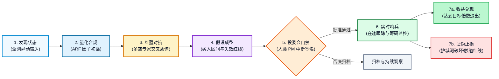
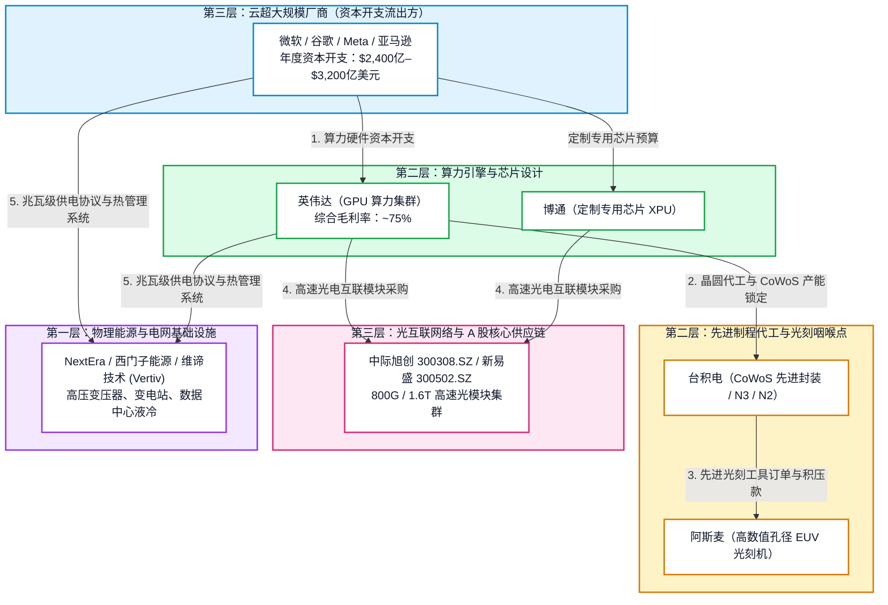
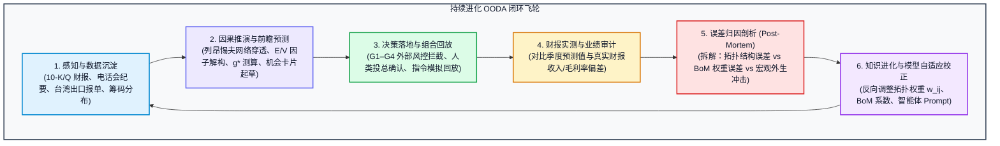

# ARF 数字投资分析师与自主 AI-CIO
## 产品愿景、多智能体协同架构、价值链传导与持续进化闭环

**发布日期：** 2026-10-28  
**架构状态：** 已批准核心规范（Approved Architecture Specification）  
**工程目标：** `ARF` / `AI-CIO` (`arf/agent/`, `arf/scoring.py`, `arf/db.py`, `arf/cio.py`, `arf/value_chain.py`, `webapp/`)  
**业务定位：** 自主型买方 AI-CIO、数字投资分析师、五层产业链发现引擎、确定性因果金融建模  
**技术渊源：** 深度继承企业级 AI 项目管理治理平台（`WoW` / `wow-ai-pm`）与 [`ADR-001 代码优先本体准则`](file:///Users/sheng/Developer/ARF/docs/ADR-001-Next-Gen-Modeling-and-Lightweight-Ontology-for-Agents.md)

---

## 1. 执行摘要：从被动工具到数字投资合伙人

现有的量化分析与股票研究软件在本质上是**被动且滞后的**：它们存储历史数据快照、按固定公式打分、绘制静态图表，然后等待人类分析师手动筛选或通过问答式对话框进行被动提问。

更致命的是，通用大模型（LLM）将公司当做**孤立的信息孤岛**来对待——写一篇孤立的英伟达纪要，一篇孤立的微软快报，或一篇孤立的中际旭创点评，彻底忽视了工业革命的核心规律：

> **在 AI 驱动的产业重塑中，企业绝非孤立存在。它们是紧密嵌套在热力学、供应链物理约束与现金流闭环回路中的动态节点：一家公司的资本开支就是另一家公司的营业收入，而上游的芯片或电力瓶颈决定了下游软件的商业回报。**

本技术规范确立了将 **ARF (AI Relevance Factor，AI 关联度因子)** 从一个静态的股票筛选器，全面进化为自主运行、主动发起的**数字投资合伙人与研究员（Digital Employee / AI-CIO）**的战略蓝图。

```
       传统 ARF 系统（静态被动）                    自主型 ARF（数字 AI-CIO 合伙人）
┌──────────────────────────────────────┐     ┌──────────────────────────────────────────────────┐
│ • 周度批处理计算管线                 │     │ • 24/7 全天候自主市场监控与异动感知             │
│ • 静态固定的 73 只股票池             │     │ • 面向全网的 AI 供应链主动穿透与雷达探索        │
│ • 经验公式计算 E 和 V 因子分位       │ ──▶ │ • 多智能体红蓝对抗审议（多空辩论机制）          │
│ • 被动交互的 Streamlit 看板          │     │ • G1–G4 外部确定性风控硬门禁（杜绝说辞欺骗）     │
│ • 孤立看待单家公司估值               │     │ • 5 层因果价值链传导与列昂惕夫网络计算          │
│ • 人工导出静态研报底稿               │     │ • 闭环回测与自适应学习飞轮（The Loop）           │
└──────────────────────────────────────┘     │ • NotebookLM 式多模态双主持播客与可信溯源       │
                                             └──────────────────────────────────────────────────┘
```

通过借鉴 **WoW** 平台成熟的多智能体双层治理模式，ARF 严格分离了**宏观主管编排（Governor）**与**专业子智能体执行（Specialist Worker）**，推行**模型外部的硬性代码风控**，并通过严格的**状态机生命周期**追踪每一项投资假设。

---

## 2. 核心架构：投资元模型与“机会 Alpha”生命周期

遵循 WoW 治理引擎的本体规范，数字投资分析师体系由五大支柱支撑：

```
┌──────────────────────────────────────────────────────────────────────────────────────────────┐
│                                   ARF 投资元模型（核心支柱）                                 │
├──────────────────────────┬───────────────────────────┬───────────────────────────────────────┤
│ 1. 机会 Alpha 生命周期   │ 2. 双层多智能体架构       │ 3. 确定性 G1–G4 治理保证              │
│    跟踪研判从发现、量化  │    主管编排中枢（宏观）   │    代码级外部金融风控门禁，           │
│    对抗、立项到退出的全流│    与沙箱专家智能体（微观│    大模型无法以“说辞”绕过硬性约束     │
├──────────────────────────┼───────────────────────────┴───────────────────────────────────────┤
│ 4. 5 层因果价值网络      │ 5. 持续改进闭环飞轮（The Loop）                                   │
│    列昂惕夫逆矩阵穿透与  │    季度财报真实值检验，自动拆解拓扑误差、参数误差与宏观冲击，     │
│    资本开支现金流闭环守恒│    自动化反向修正图谱权重与智能体 Prompt                              │
└──────────────────────────┴───────────────────────────────────────────────────────────────────┘
```

### 2.1 “机会 Alpha”生命周期状态机

在 WoW 中，**Alpha** 是在确定状态机中被严密追踪的实体。在 ARF 中，一项投资观点永远不是电子表格中的静态行，而是遵循严格准入的**机会 Alpha（Opportunity Alpha）**：



| 生命周期状态 | 状态业务内涵 | 跃迁门禁条件（Transition Gate） |
|---|---|---|
| **1. 发现 (Discovered)** | 由供应链爬虫、全网异动或财报关键词扫描初筛出的潜在受益标的 | 匹配五层架构层级（L1–L5），确认交易所合规代码 |
| **2. 量化合规 (Quant Qualified)** | 自动化计算其 Exposure ($E$) 暴露分、Valuation ($V$) 估值分、逆向 DCF 增速 $g^*$ | **硬性 G3 门禁**：$\text{ROE} \ge \text{WACC}$，未触发泡沫预警标志 |
| **3. 红蓝对抗 (Deliberating)** | 看多专项 Agent 与看空专项 Agent 针对业务护城河进行交叉审查 | 每项论点必须包含至少 2 处可核验的原生财报或公告引据 |
| **4. 假设成型 (Formulated)** | 汇编生成标准《投资机会卡片》，具备精准买入价位区间与量化证伪条件 | 给出明确估值准入区间及前瞻性业务失效指标 |
| **5. 投委会门禁 (Committee Gate)** | LangGraph 执行 `interrupt()`，阻断流程并移交人类投资总监审查 | 必须获得人类组合经理（CIO）显式点击签名批准 |
| **6. 实时哨兵 (Active Watch)** | 每日哨兵监控量价分布、筹码获利比率（CYQ）及因子漂移 | 价格位于买入区间内，成交量与筹码结构健康 |
| **7. 兑现 / 证伪 (Exit / Invalidated)** | 触碰目标估值倍数完成止盈，或触发前瞻业务预警执行纪律性止损 | 自动写入投资复盘档案，沉淀为负向微调知识库 |

---

## 3. 五层价值链传导引擎（“串点成网”）

如 [`docs/AI_CIO_CONNECTING_THE_DOTS_FINANCIAL_MODELING.md`](file:///Users/sheng/Developer/ARF/docs/AI_CIO_CONNECTING_THE_DOTS_FINANCIAL_MODELING.md) 所定义，覆盖中美两腿共 73 家标的的宇宙构建为全联通有向图：



### 3.1 四大金融传导机制
1. **资本开支-营收守恒闭环：** 云厂商 CapEx 按照硬件 BoM 拆解，严格对应上游硬件厂商的营收总额。
2. **利润转移与下游挤压：** 当上游能源与先进芯片提价时，若下游 SaaS 无法转嫁，利润将被截留在算力与能源端。
3. **中美欧三足鼎立套利：** 美系算力集群高度依赖中系光模块，中系算力自研高度依赖本土替代，而欧美共同掌控不可替代的设备与电力变压器核心瓶颈。
4. **逆向 DCF 增速协同性检验 ($g^*$)：** 若底层芯片隐含增速（38%）远超终端应用软件承受力（8%），模型将直接判定产业链估值脱节并启动泡沫预警。

---

## 4. 双层多智能体协同架构

借鉴 WoW 的分工哲学，系统将职责清晰地划分为两层：

```
┌────────────────────────────────────────────────────────────────────────────────────────┐
│ 1. 投资总监工作台与驾驶舱 (Streamlit / Next.js)                                        │
│    机会漏斗看板 · 泡沫温度计 · 因子归因 · NotebookLM 式播客简报                         │
├────────────────────────────────────────────────────────────────────────────────────────┤
│ 2. 投资主管认知中枢 (LangGraph 状态图 - arf/agent/supervisor/)                         │
│    • 每日晨会异动扫描 ──▶ 风险容忍度与买入区间检验                                      │
│    • 多空对抗研判综合 ──▶ 确定性 G3 外部代码风控                                       │
│    • 人机协同中断 (`interrupt()`) ──▶ CIO 确认后执行入池与实盘模拟                     │
├────────────────────────────────────────────────────────────────────────────────────────┤
│ 3. 专业研究员智能体矩阵 (沙箱隔离子进程 - Gemini 3.8 Flash)                            │
│    • 供应链穿透 Agent：解析 10-K 第 1 项与客户集中度，构建加权矩阵 w_ij                │
│    • 深度财务量化 Agent：计算扣非 ROE、多币种现金流贴现、逆向 DCF 隐含增速 g*          │
│    • 红方看空质询 Agent：扫描应收账款异常、专用 ASIC 替代风险、毛利率侵蚀预警          │
├────────────────────────────────────────────────────────────────────────────────────────┤
│ 4. 领域知识底盘与单事实源 (DuckDB / Cloud SQL)                                         │
│    snapshots (不可变快照) · candidate_pool (候选池) · investment_theses · telemetry    │
└────────────────────────────────────────────────────────────────────────────────────────┘
```

---

## 5. 资本安全的确定性治理保证（G1–G4）

在泛娱乐大模型中，幻觉只是笑谈；但在资产管理中，大模型的幻觉会导致灾难性的永久性资本损失。ARF 全面实施 WoW 的四项确定性治理保证：

```
┌────────────────────────────────────────────────────────────────────────────────────────┐
│                              G1–G4 外部确定性风控治理保证                              │
├────────────────────────────────────────────────────────────────────────────────────────┤
│ G1: 变更见证（Witnessed Mutation）· 每一项投资逻辑修改、买入区间调整均记录不可变快照。 │
├────────────────────────────────────────────────────────────────────────────────────────┤
│ G2: 原生可溯源（Data Provenance）· 任何核心数据均必须挂载官方财报或原始出处锚点。       │
├────────────────────────────────────────────────────────────────────────────────────────┤
│ G3: 外部代码熔断（Outside-Model Circuit Breaker）· 独立于大模型执行的确定性 Python    │
│     风控代码，LLM 绝无法“巧言令色”绕过资本安全线。                                     │
├────────────────────────────────────────────────────────────────────────────────────────┤
│ G4: 权限双轨制（Dual-Grade Authority）· 智能体只拥有研读与起草权（touch_grade），     │
│     资本分配与入库权限（commit_grade）严格保留给人类投资总监。                         │
└────────────────────────────────────────────────────────────────────────────────────────┘
```

### 5.1 G3 外部机械风控实现（代码级拦截）
```python
def mechanical_risk_gate(profile: dict[str, Any], thesis: dict[str, Any]) -> GovernanceResult:
    """确定性外部风控门禁，完全独立于 LLM 推理环境执行。"""
    # 1. 估值泡沫一票否决
    if profile.get("froth_flag") is True and thesis.get("thesis_type") == "long_opportunity":
        return GovernanceResult(
            passed=False, 
            verdict="BLOCKED_BY_G3",
            reason="G3 门禁拦截：标的处于泡沫警戒区（ARF 在 D1，ROE < 资本成本，且 P/S > 25）。"
        )

    # 2. 资本回报率底线门禁
    cost_of_equity = 0.10 if profile.get("leg") == "US" else 0.12
    if thesis.get("thesis_type") == "garp_value" and profile.get("roe", 0) < cost_of_equity:
        return GovernanceResult(
            passed=False,
            verdict="BLOCKED_BY_G3",
            reason=f"G3 门禁拦截：ROE ({profile.get('roe'):.1%}) 未达基准资本成本 ({cost_of_equity:.1%})。"
        )

    # 3. 严格证伪红线强制要求
    if not thesis.get("invalidation_criteria") or len(thesis["invalidation_criteria"]) < 20:
        return GovernanceResult(
            passed=False,
            verdict="BLOCKED_BY_G3",
            reason="G3 门禁拦截：投资假设缺少清晰、可量化的前瞻性失效证伪指标。"
        )

    return GovernanceResult(passed=True, verdict="PASSED")
```

---

## 6. 模型验证与持续进化飞轮：“The Loop”闭环

量化体系的长期生命力取决于其**自我校验与反向修正能力**。我们坚决摒弃“黑箱参数拟合”，推行基于**因果可解释性的持续改进飞轮（The Loop）**：



### 6.1 验证模型的五大确定性维度
1. **时间截面无未来信息回放（Point-in-Time Historical Replay）：** 依托 DuckDB 的不可变版本机制，严格回退至过去某一交易日，彻底排除未来数据污染。
2. **领先-滞后分析师预期修正检验（IC 检验）：** 验证下游 CapEx 爆发能否稳定在前 30–60 天预测上游供应商分析师的一致预期上调（需满足信息系数 $\text{IC} \ge 0.08$ 且 $t\text{-stat} > 3.0$）。
3. **传导追踪误差（$\beta_{\text{BoM}}$ 追踪误差校正）：** 季度核算“下游 CapEx $\times$ 理论 BoM 份额”推导的预测营收与上游披露实际营收之间的偏差。
4. **逆向 DCF 分位展开度与泡沫兑现度：** 检验被评定为第 1 分位（D1）的泡沫标的是否在未来 12 个月发生估值压缩，而 D2–D4 分位优质企业是否兑现持续超额回报。
5. **红方证伪前瞻压力测试：** 在历史重大回调事件中，复盘红方预警指标是否在行业下跌发生前触发了防御性调仓。

### 6.2 闭环持续学习飞轮（The Loop 的具体运行）
每当季度真实财报发布后，系统计算预测偏差并**自动归因进三大根因分类**：
* **A 类：图谱拓扑误差（份额切换）：** 客户将订单转向了竞争对手（例如英伟达将 15% 份额从中际旭创切至新易盛或相干公司）$\rightarrow$ 驱动智能体更新网络邻接权重 $w_{ij}$；
* **B 类：参数与 BoM 拆分误差：** 单机柜散热或光互联价值量与原先假设存在结构性出入 $\rightarrow$ 驱动量化引擎校准 $\beta_{\text{BoM}}$ 乘数；
* **C 类：宏观外生冲击：** 汇率巨幅波动（如光模块厂商账面汇兑损失）或贸易关税临时扰动 $\rightarrow$ 驱动扣非核心利润清洗规则的强化。

---

## 7. 投资决策记录（IDR）标准规范

```
┌────────────────────────────────────────────────────────────────────────────────────────┐
│                        投资决策记录 (IDR) 规范示例（全因果审计链）                      │
├────────────────────────────────────────────────────────────────────────────────────────┤
│ 1. 触发事实与市场观察                                                                  │
│    • 市场异动：Lumentum (LITE) 回撤 12% 至 68.50 美元，进入 D4 估值分位。              │
│    • 因子读数：E=88, V=52, 逆向 DCF 预期缺口=-4.2%, 筹码支撑比率=81%                   │
├────────────────────────────────────────────────────────────────────────────────────────┤
│ 2. 依据的准则与风控参数边界                                                            │
│    • 投资范围：美股第三层（光互联与网络基础设施）                                      │
│    • 边界红线：WACC=10.0%, 市销率上限 P/S=28.0, 筹码最低支撑比率=70%                  │
├────────────────────────────────────────────────────────────────────────────────────────┤
│ 3. 多空对抗审议纪要                                                                    │
│    • 看多论据：Blackwell 1.6T 光引擎放量加速，海外龙头核心份额稳固。                  │
│    • 看空反驳：前两大云厂商集中度超过 65%，面临自研定制化光电方案挤压。               │
│    • 综合裁决：在 65 美元技术与筹码强支撑位之上，风险收益不对称性极佳。                │
├────────────────────────────────────────────────────────────────────────────────────────┤
│ 4. 外部机械风控裁决 (G3)                                                               │
│    • 泡沫标志检验：FALSE (通过)                                                        │
│    • 资本回报率检验：ROE 22.4% > WACC 10.0% (通过)                                     │
│    • 门禁结论：准予进入候选池 / 提交人类投资总监裁决                                    │
├────────────────────────────────────────────────────────────────────────────────────────┤
│ 5. 执行指令与买入边界                                                                  │
│    • 建议买入区间：$65.00 – $70.00 | 纪律止损红线：综合毛利率跌破 42.0%                │
│    • 人类投资总监确认：[Sheng 于 2026-10-21 点击批准执行]                              │
└────────────────────────────────────────────────────────────────────────────────────────┘
```

---

## 8. 谷歌企业级 AI 与云原生技术展示

本系统同时作为谷歌企业级 AI、多模态与混合云基础设施的行业旗舰级标杆落地应用：
* **Gemini 3.8 Flash & Gemini 2.5 Pro (200 万上下文)：** 极速运行雷达异动过滤与整份财报万页底稿穿透；
* **谷歌搜索原生真实性接地（Search Grounding）：** 每一个事实陈述均挂载实时搜索证据药丸；
* **Nano Banana 2 与 Veo 2 视觉生成：** 自动渲染 16:9 投委会汇报信息图与 60 秒高管动态视频简报；
* **Lyria + Journey TTS 双主持音频播客：** 生成 3 分钟 NotebookLM 式晨会对话音频（Alex 乐观多头 vs Marcus 严谨风控）；
* **GCP (ai-rf-497701) + 腾讯云混合云架构：** 海外 Cloud Run 极速弹性搭配国内轻量云节点突破金融数据抓取网络限制。

---

## 9. 分阶段实施演进路线图

```
2026 Q4                      2026 Q4                      2027 Q1                      2027 Q1
第一阶段：状态机与 IDR       第二阶段：G3 外部代码风控    第三阶段：因果价值链网络     第四阶段：持续进化与多模态
┌─────────────────────────┐  ┌─────────────────────────┐  ┌─────────────────────────┐  ┌─────────────────────────┐
│ • 机会 Alpha 状态机模式 │  │ • 独立 Python 风控门禁  │  │ • 列昂惕夫投入产出逆矩阵│  │ • 季度财报全自动复盘归因│
│ • 5 步 IDR 数据库持久化 │  │ • 泡沫与低回报一票否决  │  │ • 供应链加权矩阵 w_ij   │  │ • 动态拓扑自适应校准    │
│ • Gemini 3.8 Flash 中枢 │  │ • 严格执行 G1–G4 治理    │  │ • 逆向 DCF 全网协同计算 │  │ • 双主持音频播客与视频  │
└─────────────────────────┘  └─────────────────────────┘  └─────────────────────────┘  └─────────────────────────┘
```

---

## 10. 架构总结

通过将企业级 AI 项目经理的治理规范与前沿工业金融建模完美结合：
1. **确定性代码底盘：** 坚决执行无幻觉计算，捍卫数学与会计严密性；
2. **专业子智能体矩阵：** 替代重复低效的人工阅读，快速穿透全网真实证据；
3. **外部 G3 风控拦截：** 确保概率模型绝无法逾越资本安全底线；
4. **闭环持续进化飞轮：** 让系统在每一次市场实际检验中汲取经验并自我进化；
5. **人类投资总监：** 始终掌握最终的资本调度与最高决策主权。

